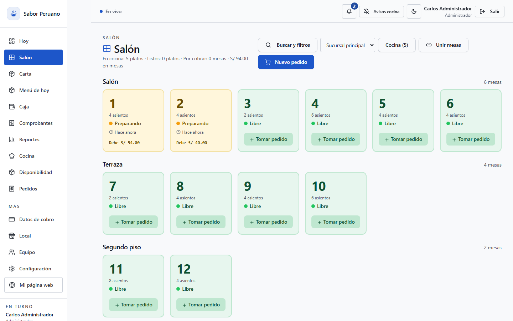
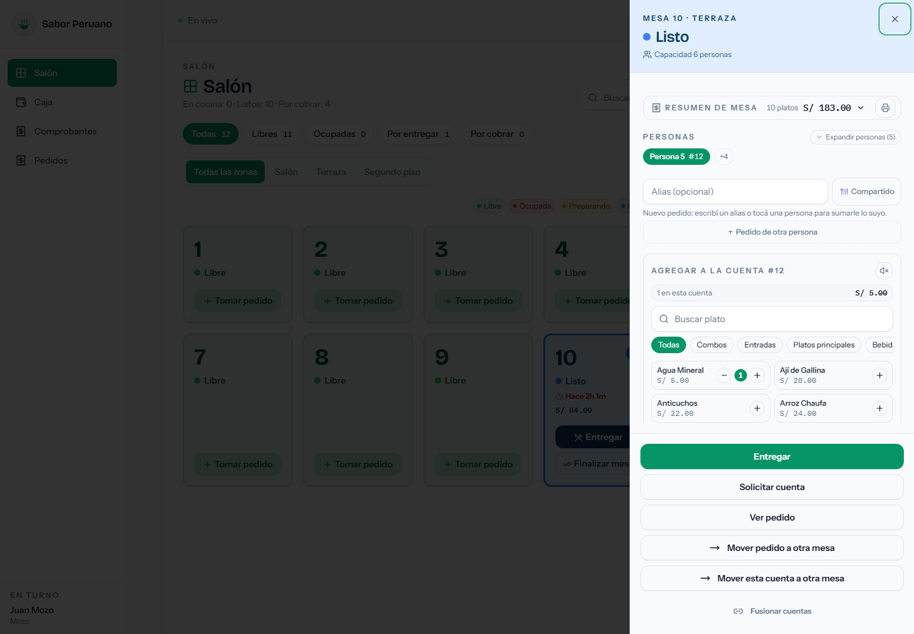
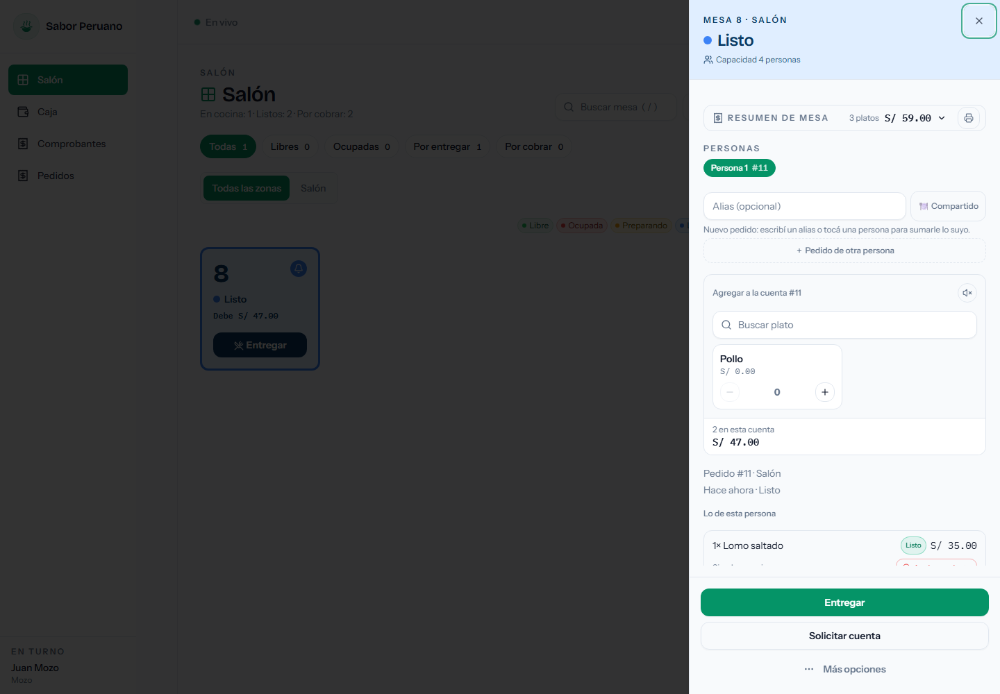
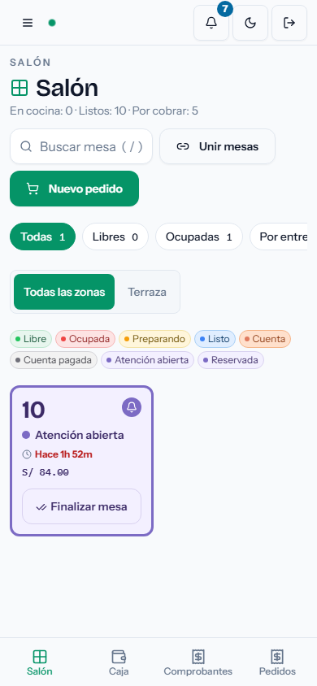

# Restaurant

**Sistema operativo para restaurantes**: salón, pedidos, cocina, caja y carta digital con QR en una sola aplicación web, multi-sucursal y multi-rol.

[](LICENSE)
[](tests)
[](backend/requirements.txt)
[](frontend/package.json)

Pensado para restaurantes de Perú (montos en soles, Yape/Plin, comprobantes), pero el modelo de datos es genérico.

> **English summary** — A production-oriented restaurant SaaS: floor plan and tables, orders, kitchen display, cash and payments, QR table ordering with optional prepayment, per-person bills, roles and reports. Built with FastAPI + MongoDB and React + Tailwind. 859 hermetic tests, MIT licensed.

## Capturas

| Salón (administrador) | Cuenta por persona |
|---|---|
|  |  |

| Comanda y cobro | Salón en móvil (mozo) |
|---|---|
|  |  |

## Empezar en dos comandos

Requisitos: Docker y Docker Compose.

```bash
cp env.example .env
docker compose up --build
```

Abre **http://localhost:8081** e inicia sesión con cualquiera de las cuentas demo:

| Rol | Correo | Contraseña |
|---|---|---|
| Administrador | `admin@resto.com` | `admin123` |
| Cajero | `cajero@resto.com` | `cajero123` |
| Mozo | `mozo@resto.com` | `mozo123` |
| Cocina | `cocina@resto.com` | `cocina123` |

`env.example` trae `APP_ENV=development` y `SEED_DEMO=true`: crea el restaurante de demostración con carta, mesas y pedidos. Para empezar de cero: `docker compose down -v` y vuelve a levantar.

> **Producción**: cambia `APP_ENV=production`, `SEED_DEMO=false` y todos los secretos. El backend se niega a arrancar con contraseñas demo, `JWT_SECRET` corto o CORS `*`. Guía completa en [docs/day-one-runbook.md](docs/day-one-runbook.md).

---

## Qué resuelve

En un restaurante pequeño la operación vive en tres lugares que no se hablan: la libreta del mozo, el WhatsApp de la cocina y la caja que no cuadra al cierre. Este proyecto reemplaza eso con un solo flujo verificable:

**mesa → pedido → cocina → entrega → cobro → comprobante**

y añade el canal del cliente (carta con QR, pedido web, seguimiento) sobre los mismos datos, sin importar pedidos dos veces.

## Funcionalidades

### Salón y mesas

| Capacidad | Detalle |
|---|---|
| Mapa de salón | Mesas por zona (Salón, Terraza, Segundo piso) con estado en vivo: libre, ocupada, preparando, listo, cuenta, cuenta pagada, atención abierta, reservada. |
| Cuentas | Varias personas por mesa, cada una con su cuenta; alias por persona y notas por pedido. |
| Reorganizar | Fusionar cuentas, mover un pedido o una cuenta a otra mesa y dividir la cuenta. |
| QR por mesa | Enlace firmado por mesa, con rotación y revocación desde configuración. |
| Tiempo real | Los cambios llegan por SSE a todas las pantallas abiertas. |

### Pedidos y atención

- Modalidades: **mesa**, **local (mostrador)**, **recojo** y **delivery**, con la misma carta.
- Flujo de atención: abrir/cerrar atención, enviar a cocina, entregar, cobrar.
- Seguimiento público del pedido por código, sin iniciar sesión.
- Recojos listos de días anteriores se separan en un historial colapsado (calendario de America/Lima) para que el pase del día no se ensucie.

### Cocina

- Pase con pedidos pendientes y en preparación, priorizados por hora de envío.
- Avisos al salón cuando un plato está listo.

### Carta, precios y disponibilidad

- Categorías, productos, combos y **menú del día**.
- Disponibilidad por producto, con excepción por sucursal (agotado en una sede, disponible en otra).
- Imágenes por URL, sin servicio de archivos propio.

### Caja y cobros

| Capacidad | Detalle |
|---|---|
| Turno de caja | Apertura con monto inicial, movimientos (ingresos/egresos) y cierre con arqueo. |
| Medios de pago | Efectivo con cálculo de vuelto, Yape, Plin, transferencia, tarjeta y pago mixto. |
| Comprobantes | Registro y consulta de comprobantes por pedido. |
| Control | Anulación de un cobro requiere motivo y aprobación del administrador. |
| Prepago | Pago opcional antes de preparar el pedido cuando el cliente pide desde el QR. |

### Canal digital del cliente

- Landing pública y carta del restaurante (`/`), con sucursales de recojo y delivery.
- Pedido desde el QR de la mesa: la mesa llega preseleccionada y el cliente puede cambiarla.
- Seguimiento del pedido por código.

### Administración

- Multi-sucursal con permisos por sucursal y roles: administrador, cajero, mozo, cocina.
- Reportes: tablero, ventas, productos y resumen del día.
- Respaldos automáticos de MongoDB (`mongodump` comprimido, retención configurable) en el servicio `backup`.
- Notificaciones internas y aprobaciones.

### En desarrollo

Estas capacidades están especificadas y en la hoja de ruta ([Issues](https://github.com/adolfoleonidas/Restaurant/issues)):

- Unir mesas para compartir una sola cuenta (hoy se resuelve fusionando cuentas).
- Asistente de voz (fases 2 y 3) y OCR de comprobantes ([docs/voice-assistant.md](docs/voice-assistant.md), [docs/proof-ocr.md](docs/proof-ocr.md)).
- Exportación a Excel y respaldo bajo demanda.
- TLS propio en producción (requiere dominio).

## Stack

| Capa | Tecnología |
|---|---|
| Backend | Python 3.12, FastAPI, Pydantic v2, Motor (MongoDB async), PyJWT, bcrypt, Uvicorn |
| Base de datos | MongoDB 7 |
| Frontend | React 18 (CRA + craco), Tailwind CSS, Radix/shadcn, TanStack Query, Recharts, Zod |
| Tiempo real | SSE con un hub en memoria (`backend/notify.py`) |
| Pruebas | pytest (859 herméticas, 908 en total), Jest + Testing Library, Playwright |
| Infra | Docker Compose, nginx, GitHub Actions (tests + despliegue), `mongodump` programado |

## Arquitectura

```
Navegador ──HTTP──▶ nginx :8081 ──/api──▶ FastAPI :8000 ──▶ MongoDB 7
                       │                      │
                  React build            SSE (eventos en vivo)
                                             │
                                    backup ──┴──▶ ./backups (mongodump)
```

Decisiones que conviene conocer antes de tocar el código:

- **Un solo proceso de backend.** El hub de SSE vive en memoria, así que el backend corre con un worker; `security_config.assert_single_process` se niega a arrancar con más. Escalar horizontalmente exige un broker compartido (p. ej. Redis pub/sub).
- **El backend no publica puertos.** Solo nginx lo alcanza; por eso `FORWARDED_ALLOW_IPS` es `*` únicamente dentro de Compose.
- **Todo pasa por `/api`.** El frontend usa `REACT_APP_BACKEND_URL` como base y nginx enruta `/api/` al backend.
- **Los estados del pedido y de la mesa son explícitos.** Ver [docs/estados-y-flujo.md](docs/estados-y-flujo.md) antes de añadir una transición.

## Desarrollo local

**Backend**

```bash
python -m venv backend/.venv
source backend/.venv/bin/activate        # Windows: backend\.venv\Scripts\activate
pip install -r backend/requirements.txt

# MongoDB escuchando en localhost:27017
export MONGO_URL=mongodb://localhost:27017
export DB_NAME=restaurant_db
export JWT_SECRET=una-clave-unica-de-al-menos-32-caracteres
export CORS_ORIGINS=http://localhost:3000
export APP_ENV=development SEED_DEMO=true

cd backend && uvicorn server:app --reload --port 8000
```

En PowerShell: `$env:MONGO_URL='mongodb://localhost:27017'` y así con cada variable. Documentación interactiva de la API: **http://localhost:8000/docs**.

**Frontend**

```bash
cd frontend
npm install
REACT_APP_BACKEND_URL=http://localhost:8000 npm start   # http://localhost:3000
```

## Pruebas

```bash
# Suite hermética (la que corre CI): no necesita API ni base de datos
python -m pytest tests -m "not integration"

# Todo, incluida la integración: requiere `docker compose up`
python -m pytest tests

# Frontend: unitarias y de componente (CI=true evita el modo interactivo)
cd frontend && CI=true npm test

# Extremo a extremo (requiere el stack arriba)
cd frontend && npx playwright test
```

`pytest.ini` expone `backend/` en `pythonpath`, así que las pruebas se lanzan desde la raíz del repositorio.

## Documentación

| Documento | Para qué |
|---|---|
| [docs/README.md](docs/README.md) | Índice de toda la documentación, ordenado por lo que quieras hacer. |
| [docs/recorrido-demo.md](docs/recorrido-demo.md) | Recorrido guiado de 5 minutos con los datos demo. |
| [docs/spec/README.md](docs/spec/README.md) | Índice de la especificación: PRD, modelo de dominio, estados y UI/UX. |
| [docs/estados-y-flujo.md](docs/estados-y-flujo.md) | Máquinas de estado de pedido, mesa, pago y caja. |
| [docs/day-one-runbook.md](docs/day-one-runbook.md) | Puesta en marcha real, respaldos y restauración. |
| [docs/design-system.md](docs/design-system.md) | Tokens, componentes y reglas visuales. |
| [docs/releases/](docs/releases/) | Notas de las funcionalidades entregadas (QR de mesa, prepago, recojos de días previos). |
| [docs/audit/](docs/audit/) | Auditorías funcionales y de flujo por roles. |

## Estado del proyecto

Mantenido por una sola persona, en desarrollo activo: 646 commits desde junio de 2026, 859 pruebas herméticas y un workflow de GitHub Actions que ejecuta pruebas y despliegue. Lo que falta hoy es alcance, no ingeniería: instalación más simple, demostración pública y adopción por otros restaurantes.

## Contribuir

Los issues y pull requests son bienvenidos; la guía completa está en [CONTRIBUTING.md](CONTRIBUTING.md). Antes de enviar un cambio:

- [ ] `python -m pytest tests -m "not integration"` en verde.
- [ ] `cd frontend && CI=true npm test && npm run build` sin errores.
- [ ] Los cambios de comportamiento actualizan `docs/spec/` y, si aplica, `docs/estados-y-flujo.md`.
- [ ] Un cambio por PR, con el porqué en la descripción.

## Licencia

[MIT](LICENSE) © 2026 adolfo leonidas · [@adolfoleonidas](https://github.com/adolfoleonidas)
