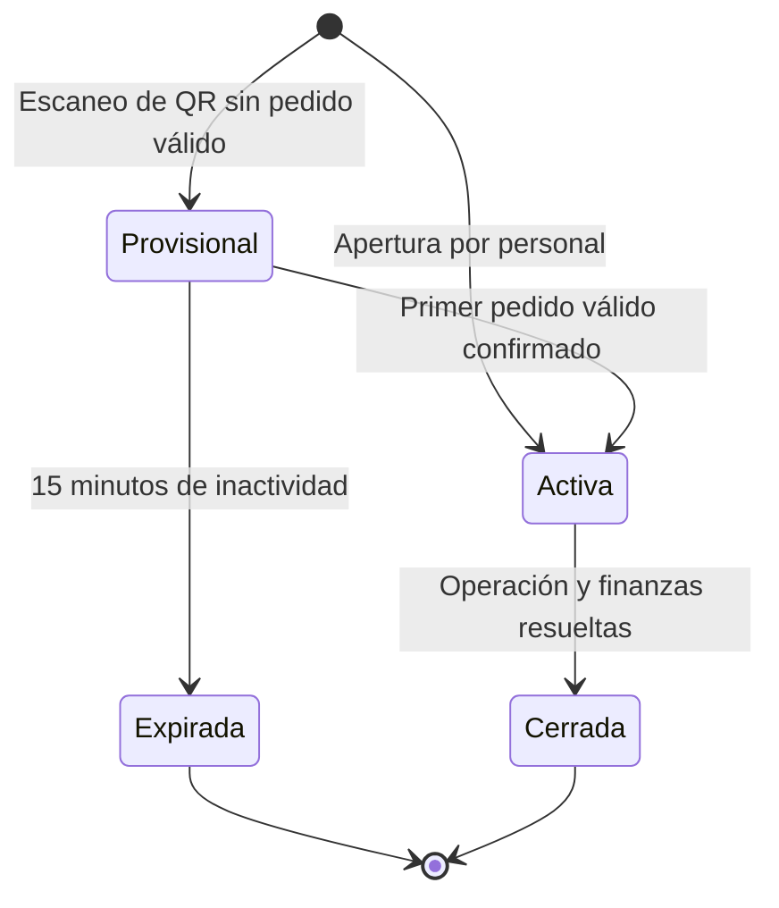
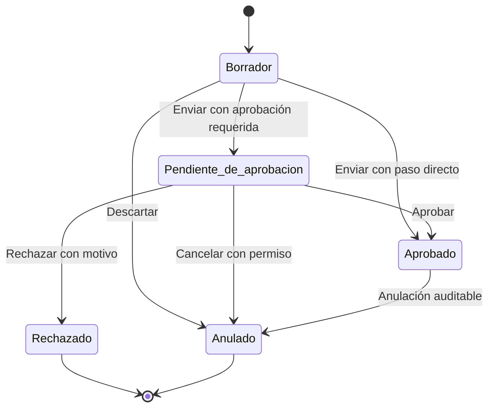
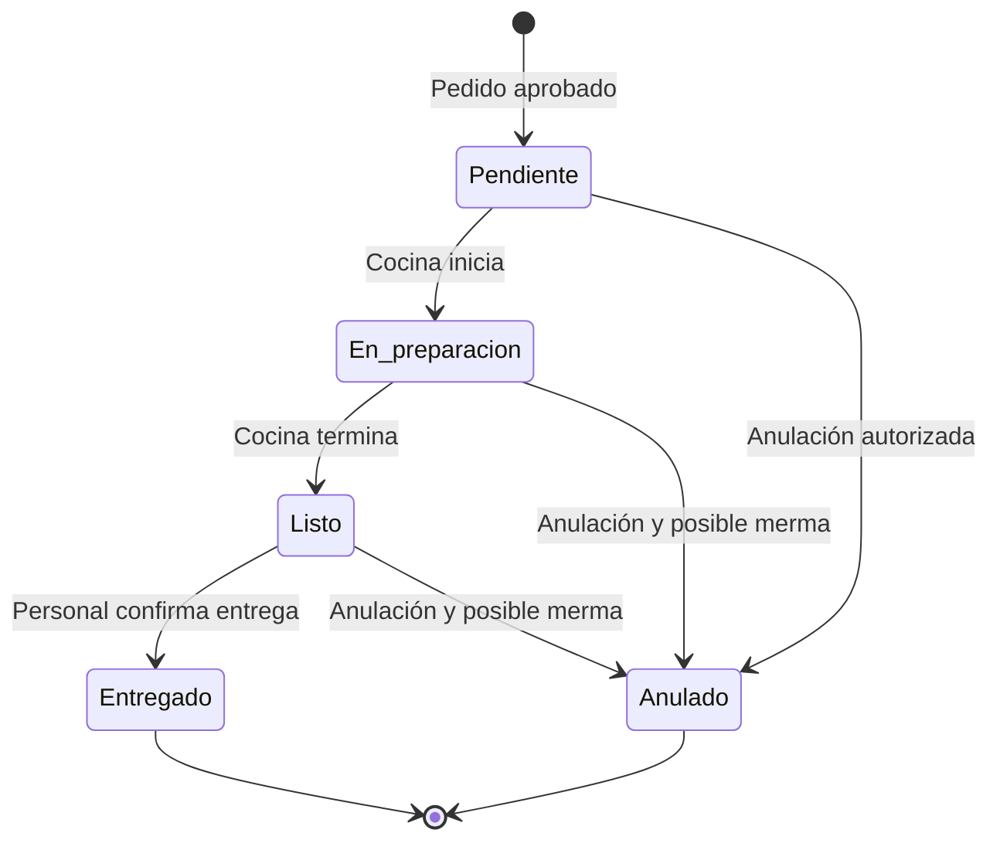
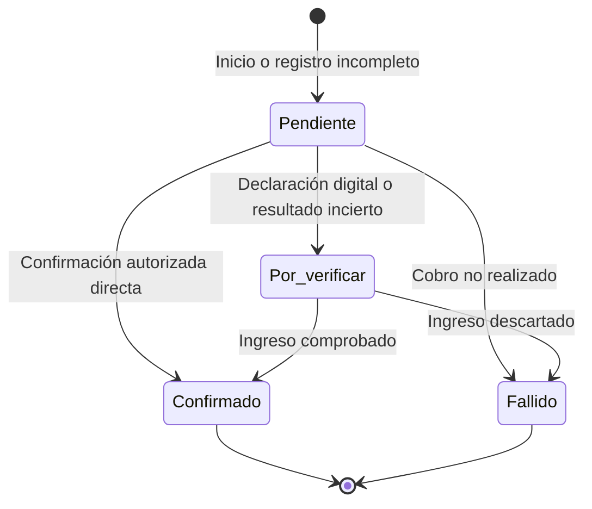
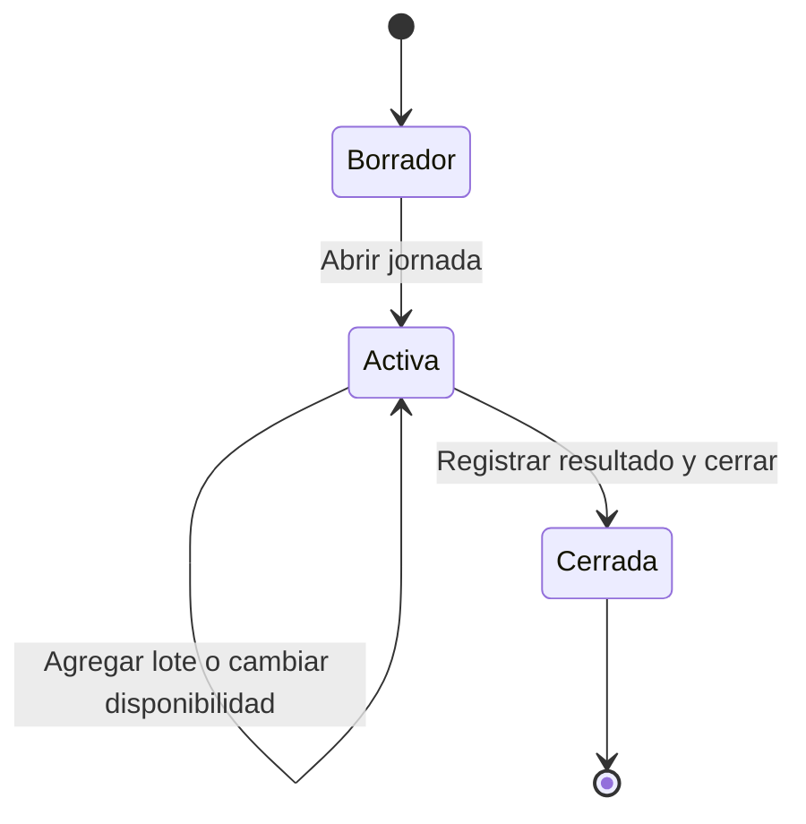
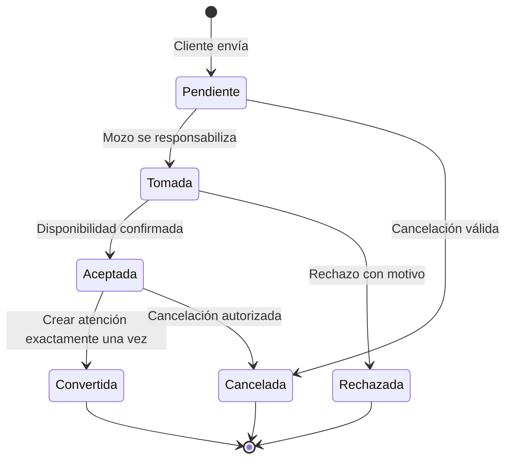
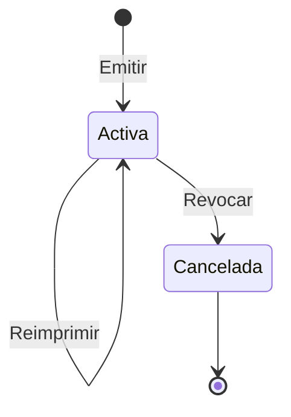
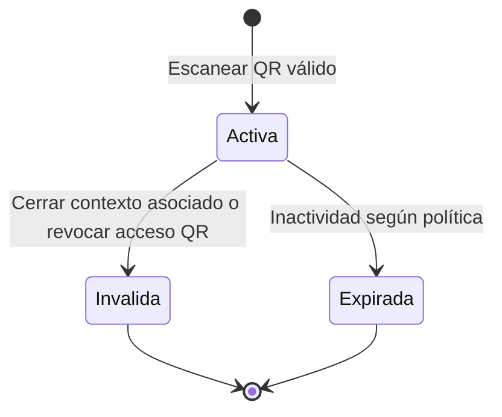

# Especificación funcional y de estados 0.1

**Producto:** SaaS operativo para restaurantes  
**Estado:** borrador para validación funcional  
**Mercado inicial:** restaurantes pequeños de menú; piloto en Ica, Perú  
**Alcance:** MVP operativo, sin facturación electrónica  
**Fuentes:** `PRD-restaurante-saas-v1.0.md` y `modelo-de-dominio-restaurante-saas-v0.1.md`

## 1. Propósito

Este documento transforma el PRD y el modelo de dominio en comportamientos comprobables. Define quién puede ejecutar cada acción, cómo progresa cada proceso, qué condiciones habilitan o bloquean una transición y qué resultado debe observar el usuario.

No define todavía pantallas finales, tablas de base de datos, endpoints, infraestructura ni tecnologías.

## 2. Ruta rápida de lectura

1. Revisar el flujo operativo principal de la sección 7.
2. Validar las máquinas de estados de la sección 9.
3. Confirmar reglas y excepciones de las secciones 10 y 11.
4. Utilizar los criterios de aceptación de la sección 12 como base para UX, pruebas e implementación.

## 3. Alcance funcional del MVP

### 3.1 Incluido

- Operación SaaS aislada por negocio y sucursal.
- Usuarios, roles configurables y permisos por capacidad.
- Atenciones En mesa/Para llevar, varias cuentas por atención y varias atenciones independientes por mesa.
- Ocupación física independiente, agrupación operativa y liberación separada del cierre financiero.
- QR estable por mesa con cancelación y reemplazo.
- Pedidos del mozo, del cliente por QR y de la web pública.
- Pedidos para llevar inmediatos y programados.
- Catálogo maestro, precios locales e importación Excel o CSV.
- Menús compuestos, opciones, notas, descuentos y cortesías.
- Jornada, disponibilidad y lotes de producción.
- Tablero de cocina obligatorio.
- Entrega coordinada entre mozos.
- Pagos manualmente registrados con efectivo, Yape, Plin y tarjeta.
- Cuenta completa o dividida.
- Cierre de atención y cierre diario de caja como procesos separados.
- Correcciones, anulaciones, mermas y devoluciones auditables.
- Constancia interna de consumo.
- Reportes operativos básicos por día y sucursal.
- Cola local del mozo ante cortes breves de internet.

### 3.2 Fuera del MVP

- Facturación electrónica y conexión con SUNAT.
- Procesamiento bancario automático.
- Delivery y gestión de repartidores a domicilio.
- Reserva anticipada de mesas.
- Inventario de ingredientes, recetas, compras y almacenes.
- Programación semanal automática del menú.
- Registro público, cobro de suscripciones y autoservicio comercial del SaaS.
- Operación completa por red local, Bluetooth o servidor dentro del restaurante.
- Analítica histórica avanzada y comparativos entre sucursales.

## 4. Principios funcionales

1. **La atención organiza el consumo.** Una persona o grupo puede realizar varios pedidos dentro de la misma atención.
2. **Los procesos avanzan de manera independiente.** Pedido, preparación, entrega, pago y cierre no comparten un único estado.
3. **La mesa ubica; no identifica al cliente.** Las mesas pueden moverse o agruparse sin cambiar su identidad.
4. **El QR identifica ubicación; sesión representa contexto autorizado.** Persona, atención, cuenta y dispositivo no son equivalentes; no hay unión automática.
5. **La declaración de pago no confirma dinero.** Solo una verificación autorizada reduce el saldo.
6. **El historial no se reescribe.** Operaciones sensibles se corrigen mediante movimientos vinculados y auditables.
7. **Los reintentos no duplican resultados.** Pedidos, pagos, entregas, importaciones y conversiones deben ser idempotentes.
8. **Los permisos se aplican en el servidor.** Ocultar controles en la interfaz no constituye seguridad.

## 5. Actores y capacidades

Los roles son plantillas iniciales. El propietario puede asignar capacidades adicionales sin mezclar los roles internos de la plataforma con los del restaurante.

### 5.1 Actores

| Actor | Responsabilidad principal |
|---|---|
| Propietario de plataforma | Administrar el SaaS, sin pertenecer a los negocios clientes. |
| Soporte de plataforma | Resolver incidencias con acceso restringido, temporal y auditado. |
| Propietario del restaurante | Controlar el negocio, sus sucursales, configuración y reportes. |
| Administrador o encargado | Gestionar la operación diaria de las sucursales autorizadas. |
| Mozo | Abrir atenciones, tomar o aprobar pedidos, coordinar entrega y, con permiso, cobrar y cerrar. |
| Cocina | Controlar disponibilidad, preparación y productos listos. |
| Caja | Registrar y verificar pagos, cerrar atenciones y conciliar el turno. |
| Repartidor de platos | Tomar productos listos y registrar su entrega, si el negocio utiliza el rol. |
| Cliente QR | Consultar catálogo y operar únicamente sobre su sesión privada. |
| Cliente web | Solicitar un pedido para llevar inmediato o programado. |

### 5.2 Capacidades predeterminadas del restaurante

La siguiente matriz expresa valores iniciales, no una rigidez permanente.

| Capacidad | Propietario | Administrador | Mozo | Cocina | Caja | Repartidor |
|---|---:|---:|---:|---:|---:|---:|
| Configurar negocio y sucursales | Sí | Según permiso | No | No | No | No |
| Gestionar usuarios y roles | Sí | Según permiso | No | No | No | No |
| Configurar mesas y QR | Sí | Sí | No | No | No | No |
| Gestionar catálogo y precios | Sí | Sí | No | Según permiso | No | No |
| Importar o exportar catálogo | Sí | Sí | No | No | No | No |
| Abrir jornada | Sí | Sí | Según permiso | Sí | No | No |
| Cambiar disponibilidad | Sí | Sí | Según permiso | Sí | No | No |
| Crear atención y pedido | Sí | Sí | Sí | No | No | No |
| Aprobar pedido QR | Sí | Sí | Sí | No | No | No |
| Tomar solicitud web | Sí | Sí | Sí | No | No | No |
| Cambiar estado de preparación | Sí | Sí | No | Sí | No | No |
| Adjudicarse y entregar | Sí | Sí | Sí | No | No | Sí |
| Registrar efectivo | Sí | Sí | Según permiso | No | Sí | No |
| Verificar Yape o Plin | Sí | Sí | Según permiso | No | Sí | No |
| Registrar tarjeta externa | Sí | Sí | Según permiso | No | Sí | No |
| Cerrar atención | Sí | Sí | Sí por defecto | No | Sí | No |
| Cerrar caja diaria | Sí | Según permiso | No | No | Sí | No |
| Anular, descontar o dar cortesía | Sí | Según límites | Según límites | No | Según límites | No |
| Consultar reportes | Sí | Según permiso | No | No | Según permiso | No |

### 5.3 Reglas de acceso

- Cada usuario operativo posee una sola sucursal activa.
- Trasladar un usuario cambia su sucursal activa, pero no altera su historial.
- El propietario puede consultar todas las sucursales de su negocio.
- Un restaurante nunca puede asignar permisos de plataforma.
- Las acciones financieras y administrativas sensibles requieren capacidad explícita.
- Cada acción conserva actor, sucursal, fecha, motivo e identidad de operación cuando corresponda.

## 6. Objetos operativos visibles

| Objeto | Identificador visible | Función |
|---|---|---|
| Atención | Número de atención | Visita estable; identidad interna desde la creación y número visible asignado al primer pedido válido confirmado. Secuencia por sucursal y día de negocio local. |
| Mesa | Número de mesa | Permite ubicar y agrupar clientes dentro del local. |
| Pedido | Número o secuencia dentro de la atención | Registra una solicitud concreta de productos. |
| Número de retiro | Número visible de atención | Usa la secuencia común En mesa/Para llevar por sucursal y día de negocio local. |
| Jornada | Nombre y fecha | Organiza disponibilidad y producción de un servicio. |
| Cuenta | Referencia dentro de la atención | Agrupa importes para el cobro completo o dividido. |
| Turno de caja | Responsable y apertura | Consolida pagos y conciliación diaria. |
| Alias de servicio | Nombre opcional no único ni identificador para llamar/entregar. |
| Destino de entrega | Mesa específica actual del pedido En mesa, distinta de origen/grupo de mesas. |

Los identificadores técnicos internos no deben depender de estos números visibles ni exponerse como credenciales de seguridad.

Los números visibles de atención y retiro pueden repetirse en días o sucursales diferentes. El identificador técnico interno permanece único, inmutable y nunca se reutiliza.

## 7. Flujo operativo principal

### 7.1 Atención En mesa iniciada por un mozo

1. El mozo inicia sesión y el sistema reconoce su sucursal activa.
2. Selecciona una o varias ubicaciones; la mesa puede alojar otras atenciones independientes.
3. El sistema crea una atención activa y asigna al mozo como responsable principal.
4. El mozo puede indicar alias opcional; cada pedido En mesa debe indicar mesa destino específica.
5. El mozo agrega productos individuales o menús compuestos.
6. Antes de enviar, puede modificar libremente el pedido.
7. Al enviar, el pedido se aprueba según la política y genera trabajo en cocina.
8. Cocina prepara y marca productos como listos.
9. El mozo responsable u otro autorizado se adjudica la entrega y la confirma.
10. Se registran y confirman uno o varios pagos.
11. Un usuario con permiso cierra la atención cuando todas las condiciones se cumplen.
12. El cierre financiero no libera una mesa con personas u otras atenciones; el personal confirma la salida por separado y los demás contextos siguen disponibles.

### 7.2 Atención iniciada por QR

1. El cliente escanea el QR estable de mesa, que identifica ubicación y no persona/cuenta.
2. El sistema valida que la credencial esté activa y resuelve negocio, sucursal y mesa.
3. La web muestra la mesa identificada y solicita confirmación antes del primer pedido.
4. Inicia atención independiente o solicita asociación explícita autorizada; escanear no une a terceros.
5. Recibe contexto privado autorizado; navegador/dispositivo no es identidad ni revela datos ajenos.
6. El cliente arma y envía su pedido.
7. La política de la sucursal determina si requiere aprobación del mozo.
8. Al aprobar el primer pedido válido, la atención queda activa y cocina recibe el trabajo.
9. Consulta pedidos/saldos autorizados. Cuenta/atención cerrada no admite pedidos; otros contextos abiertos autorizados permanecen disponibles.
10. El personal autorizado consulta la atención completa.

### 7.3 Unión de mesas

1. El mozo selecciona una atención activa y solicita agregar otra mesa.
2. Se mantiene la ocupación existente y puede iniciarse otra atención independiente en la misma mesa.
3. El movimiento actualiza ubicación operativa, no une atenciones/cuentas ni transfiere consumos/pagos.
4. Los QR de todas las mesas continúan funcionando.
5. Cada contexto autorizado conserva privacidad; navegador/dispositivo no equivale a persona ni impone una cuenta por dispositivo.
6. Solo asociación explícita reúne pedidos; compartir mesa/QR/grupo no une clientes o cuentas.

### 7.4 Para llevar desde el personal

1. El mozo o caja crea una atención **Para llevar**.
2. El sistema genera un número de retiro.
3. Se puede registrar un nombre o alias opcional.
4. El pedido sigue el mismo flujo de aprobación, cocina, entrega y pago.
5. La atención no ocupa mesas.
6. Alias es opcional; referencias de retiro/pedido conservan trazabilidad.

### Identificación del servicio y destino

El alias es opcional para En mesa/Para llevar, puede repetirse o cambiar y no se exige un nombre legal; no acredita identidad, permiso ni titularidad. No se requiere registro ni inicio de sesión del cliente para usar el alias; no se exige DNI ni un dispositivo único. Las referencias de atención/pedido/retiro distinguen alias repetidos; una referencia visible no permite ver datos ajenos.

Cada pedido En mesa tiene destino de mesa específico aunque la atención cubra varias mesas. Origen, grupo y destino vigente son distintos. Personal autorizado puede actualizar pedidos no entregados; guarda destino anterior/nuevo, actor y momento, y actualiza la vista de responsable/KDS. No cambia atención, cuenta, pagos ni pedidos entregados. Un movimiento de mesa no redirige automáticamente otros pedidos.

Starbucks documenta nombres elegidos para pedidos de cafetería; KFC UK describe el retiro de pedidos realizados en su aplicación; Burger King New Zealand indica comunicar el número al recoger un pedido móvil anticipado. Son ejemplos por canal/mercado, no evidencia sobre pedidos ordinarios en mostrador, quioscos ni todas las sucursales peruanas, y no prueban identidad. Esta adaptación usa alias opcional, referencias y destino, sin importar check-in/drive-through. [Starbucks](https://about.starbucks.com/press/2025/customer-names-and-messages-on-orders/), [KFC UK](https://help.kfc.co.uk/hc/en-gb/articles/360018467939-PICKING-UP-MY-ORDER), [Burger King NZ](https://burgerkingnz.zendesk.com/hc/en-us/articles/6987086128015-How-do-I-place-a-mobile-pre-order).

### 7.5 Para llevar desde la web pública

1. El cliente llega desde Google, redes sociales o un enlace general.
2. Consulta el catálogo sin recibir una mesa implícita.
3. Selecciona retiro inmediato o programado.
4. Envía productos, hora solicitada, alias y contacto opcional.
5. La solicitud entra en una bandeja compartida de la sucursal.
6. El primer mozo que la toma pasa a ser responsable.
7. El responsable verifica disponibilidad y horario.
8. Si acepta, se genera una atención Para llevar exactamente una vez.
9. Si rechaza, registra un motivo visible para la operación interna.
10. Solo la solicitud aceptada llega a cocina y obtiene número de retiro.

Para el retiro programado, cada sucursal puede configurar la anticipación mínima y la ventana de retiro. Los valores predeterminados del piloto son 30 minutos de anticipación y una ventana de 15 minutos contada desde la hora seleccionada; por ejemplo, una solicitud para la 1:00 p. m. utiliza la ventana de 1:00 a 1:15 p. m.

Una solicitud nueva genera una alerta inmediata. Si permanece sin responsable durante 2 minutos, cambia a prioridad urgente y repite la alerta para todos los mozos autorizados de la sucursal. La escalación no acepta ni rechaza automáticamente la solicitud.

### 7.6 Menú compuesto

1. El usuario selecciona el producto **Menú**.
2. El sistema solicita las elecciones configuradas, por ejemplo entrada y segundo.
3. Agrega los componentes incluidos, como refresco o postre.
4. El menú conserva un único importe cobrado.
5. Los componentes se registran individualmente con precio aplicado cero y motivo **Incluido en menú**.
6. Cocina y disponibilidad pueden controlar los componentes sin duplicar el cobro.
7. El mismo componente vendido por separado utiliza su precio normal.

### 7.7 Pago y cierre

1. El personal o el cliente inicia el pago del saldo que puede consultar.
2. Efectivo y tarjeta externa se registran por un usuario con permiso.
3. En Yape o Plin, el cliente ve monto, QR, número copiable, receptor y número de atención.
4. **Ya pagué** crea una declaración **Por verificar**.
5. Caja o un mozo autorizado verifica el ingreso en el medio oficial.
6. Solo la confirmación reduce el saldo.
7. Cuando todos los pedidos están resueltos, el saldo es cero y no existen pagos inciertos, se habilita el cierre.
8. **Cobrar y cerrar** combina las acciones cuando el usuario posee ambas capacidades.

## 8. Requisitos funcionales por capacidad

### RF-01 — Gestionar una atención

El sistema debe permitir crear, activar, consultar y cerrar una atención numerada sin utilizar el nombre del cliente como identificador obligatorio.

Reglas:

- Una atención En mesa necesita al menos una mesa al activarse.
- Una atención Para llevar necesita número de retiro y no ocupa mesa.
- Una atención cerrada no se reabre ni se elimina.
- Una compra posterior a una visita cerrada crea otra atención; si la visita permanece abierta tras liquidar una cuenta, se utiliza otra cuenta abierta.
- Una atención provisional sin pedido válido expira después de 15 minutos de inactividad y no genera una venta.
- La secuencia de atención es común En mesa/Para llevar y estable durante la visita; asignación, ámbito y reinicio siguen pendientes. Identidad técnica única y no reutilizada.

### RF-02 — Gestionar mesas móviles

El sistema debe permitir agregar, cambiar o liberar mesas durante una atención.

Reglas:

- Varias atenciones independientes pueden coexistir en una mesa; disponibilidad considera ocupación y todas las asociaciones activas.
- Mover físicamente una mesa no cambia su número ni historial.
- Entregar productos no libera la mesa.
- Cierre financiero no libera físicamente mesa con personas/otras atenciones; personal autorizado confirma vacancia.

### RF-03 — Administrar la credencial QR

El sistema debe generar, descargar, reimprimir, cancelar y reemplazar el QR de una mesa.

Reglas:

- Reimprimir conserva la misma credencial.
- Cancelar impide nuevas sesiones y pedidos desde el QR anterior.
- Reemplazar crea una credencial nueva para la misma mesa.
- El número y el historial de la mesa permanecen intactos.

### RF-04 — Tomar pedidos desde varios canales

El sistema debe recibir pedidos desde el área del mozo, el QR de mesa y la web pública, conservando su origen.

Reglas:

- Todos los canales utilizan el mismo catálogo y flujo interno.
- El acceso del mozo requiere autenticación; no depende del QR.
- La web pública no permite elegir una mesa escribiendo un número.
- Cada pedido conserva creador, origen y confirmador.

### RF-05 — Aplicar políticas de aprobación QR

Cada sucursal debe configurar uno de estos modos:

1. Aprobar cada pedido.
2. Aprobar el primero y permitir directamente los siguientes de la sesión activa.
3. Enviar directamente con código temporal de jornada y límites de seguridad.

El modo predeterminado del piloto es **Aprobar cada pedido**.

Cuando una sucursal active el modo directo a cocina, los límites predeterminados serán 20 unidades por envío y 3 envíos dentro de 5 minutos por sesión. Superar un límite no elimina ni rechaza automáticamente el pedido: lo deriva a aprobación del mozo antes de que llegue a cocina. Los límites pueden endurecerse por sucursal, pero no desactivarse silenciosamente sin advertir el riesgo.

### RF-06 — Proteger la privacidad del cliente QR

Cada persona/grupo opera en un contexto privado autorizado; navegador/dispositivo no es identidad.

Reglas:

- El cliente consulta únicamente su carrito, pedidos, estados y saldo.
- No consulta productos ni totales de otras sesiones.
- Unir mesas no fusiona las vistas privadas.
- El personal autorizado consulta la atención completa.
- Cerrar atención impide publicar en ese contexto; cerrar cuenta impide nuevos consumos allí, sin bloquear otros contextos abiertos autorizados.
- Sesión no publica en cuenta/atención cerrada. Cerrar una cuenta no bloquea otros contextos abiertos autorizados.

### RF-07 — Controlar catálogo y precios por sucursal

El negocio debe mantener un catálogo maestro y cada sucursal debe administrar habilitación, disponibilidad y precio local.

Reglas:

- Cambiar el precio local no modifica otras sucursales.
- El pedido conserva el nombre, composición y precio aplicados históricamente.
- Un producto utilizado no se elimina físicamente; se archiva.
- La disponibilidad de jornada puede restringir una oferta habilitada, pero no reactivar una archivada.

### RF-08 — Importar y exportar el catálogo

El sistema debe aceptar Excel `.xlsx` y CSV para acelerar la carga inicial.

Reglas:

- Debe existir una plantilla descargable.
- La actualización utiliza identificador interno o SKU, no solo el nombre.
- Antes de aplicar, muestra altas, modificaciones, archivados y rechazos.
- Cada error identifica fila, campo y motivo.
- Aplicar requiere confirmación autorizada y ocurre exactamente una vez.
- Antes del cambio masivo se conserva una versión recuperable.

### RF-09 — Operar una jornada

El sistema debe permitir crear y abrir jornadas configurables, inicialmente **Almuerzo**.

Reglas:

- La disponibilidad admite **Disponible sin conteo**, **Cantidad limitada** y **Agotado**.
- Cocina puede agregar varios lotes durante la misma jornada.
- Agotar un producto impide pedidos nuevos, pero no altera los existentes.
- El cierre registra vendidos, sobrantes y mermas.

### RF-10 — Operar el tablero de cocina

El KDS debe mostrar únicamente preparaciones provenientes de pedidos aprobados.

Cada tarjeta debe mostrar:

- Referencias de atención/pedido, mesa destino específica o retiro, alias opcional.
- Productos y cantidades.
- Opciones y notas.
- Tiempo de espera.
- Origen como información secundaria.
- Origen histórico es distinto de grupo/destino actual; cambio autorizado no entregado conserva anterior/nuevo/actor/momento y no altera finanzas.

El tablero debe permitir seguimiento por producto y, opcionalmente, por componentes del menú.

### RF-11 — Coordinar la entrega

Cuando cocina marca un producto como listo, el responsable recibe una alerta y el elemento permanece visible para el equipo.

Reglas:

- Solo una persona puede adjudicarse activamente la entrega.
- Otro mozo autorizado puede seleccionar **Me encargo**.
- Marcar **Entregado** lo retira del tablero activo, no del historial.
- La entrega no modifica pagos ni libera mesas.

### RF-12 — Dividir y pagar cuentas

Permite cobrar una cuenta o dividir consumos por comensal/producto/monto y combinar medios; un pago conjunto conserva asignaciones originales sin fusionar deudas automáticamente.

Reglas:

- Un producto no puede asignarse y cobrarse dos veces.
- La suma asignada no puede superar el total.
- Solo pagos confirmados reducen el saldo.
- El cliente QR solo puede iniciar pagos sobre su saldo privado.
- Pagar la atención completa requiere el área operativa y el permiso correspondiente.
- Cada consumo se asigna a una cuenta abierta; los compartidos se asignan explícitamente sin duplicar ni superar el total. Ninguna cuenta puede cerrarse si hay consumos sin asignar o contabilizar. Para cerrar una cuenta, todos sus productos deben estar entregados o correctamente cancelados, su saldo confirmado debe ser cero y no debe haber pagos pendientes o sin verificar. Las asignaciones y pagos confirmados son inmutables y auditables.
- Cuenta cerrada no acepta consumo; atención abierta puede continuar con cuenta nueva. Movimientos no transfieren pagos confirmados.

### RF-13 — Controlar pagos digitales manuales

La aplicación debe mostrar QR y número copiable de Yape o Plin, pero no debe interpretar una intención como confirmación.

Reglas:

- **Ya pagué** deja el pago Por verificar.
- La captura del cliente no constituye evidencia suficiente.
- Un usuario autorizado verifica el ingreso en la fuente oficial.
- Una interrupción no provoca reintento automático ni duplicación.
- La tarjeta se cobra en un POS externo y se registra manualmente.

### RF-14 — Cerrar una atención

El sistema debe permitir el cierre solamente cuando:

- Todos los pedidos están entregados o anulados correctamente.
- El saldo confirmado es cero.
- No existen pagos Pendientes o Por verificar.

El permiso **Cerrar atención** es independiente de los permisos de cobro y de cierre de caja.

Cerrar cuenta, atención, liberar mesa y cerrar caja son distintos. Atención cerrada no se reabre ni recibe pedidos. Liberación física requiere confirmación autorizada.

### RF-15 — Controlar caja

Cada sucursal puede utilizar:

- **Caja controlada:** apertura, monto inicial, movimientos, conciliación y cierre.
- **Caja simple:** registro de pagos sin arqueo obligatorio.

La caja controlada es el valor inicial recomendado.

El cierre diario se bloquea mientras existan atenciones abiertas o pagos Por verificar.

### RF-16 — Corregir sin borrar historial

El sistema debe permitir correcciones según el avance:

- Antes de cocina: edición libre del borrador.
- Enviado, pero no preparado: anulación con permiso y motivo.
- En preparación o listo: anulación auditable y posible merma.
- Después del pago: corrección o devolución por caja o administración.

El registro original siempre permanece disponible.

Límites predeterminados, configurables por restaurante:

- El mozo puede aplicar descuentos de hasta 10 % y anular antes de iniciar la preparación, con permiso y motivo.
- Caja puede aplicar descuentos de hasta 15 % y realizar correcciones financieras según sus capacidades asignadas.
- Propietario y administrador no tienen un límite porcentual predeterminado, pero toda acción exige motivo y auditoría.
- Superar el límite del usuario deriva la acción a aprobación de propietario o administrador.
- Si la preparación ya comenzó o el pago fue confirmado, los límites no sustituyen las reglas más estrictas de anulación, merma, corrección o devolución.

### RF-17 — Mantener continuidad ante cortes breves

El dispositivo del mozo debe guardar localmente los pedidos no sincronizados.

Estados visibles:

- Guardado en el dispositivo.
- Pendiente de sincronización.
- Recibido por cocina.

Al recuperar internet, cada operación se sincroniza una sola vez. El QR y la comunicación digital con cocina requieren conexión.

La continuidad local del MVP debe soportar hasta 8 horas sin conexión y 500 operaciones pendientes por dispositivo. Al alcanzar el 80 % de la capacidad, la aplicación muestra una advertencia persistente. Si llega al límite, conserva todas las operaciones existentes, detiene nuevos registros digitales y solicita utilizar el procedimiento manual hasta recuperar conexión; nunca elimina datos pendientes silenciosamente.

### RF-18 — Emitir constancia interna

El sistema debe generar una constancia digital sin valor tributario con atención, sucursal, productos, totales, pagos y fecha. La impresión es opcional y su falla no puede invalidar el pago ni reabrir la atención.

### RF-19 — Producir reportes básicos

El sistema debe presentar por día y sucursal ventas, atenciones, ticket promedio, productos, medios de pago, descuentos, anulaciones, cortesías, producción, sobrantes y mermas.

### RF-20 — Conservar, respaldar y eliminar datos de forma segura

El sistema debe aplicar políticas diferentes según la finalidad y la obligación asociada con cada dato.

Política inicial:

- Los registros operativos o financieros que sustenten obligaciones tributarias se conservan durante 5 años o durante el plazo de prescripción aplicable, el que resulte mayor.
- Los registros de acceso, modificación, importación, exportación y demás trazas de tratamiento de datos personales se conservan durante un mínimo de 2 años.
- El nombre, alias, teléfono u otro contacto opcional del cliente se elimina o anonimiza 90 días después de finalizar su última operación, salvo reclamo, investigación, consentimiento válido u obligación legal vigente.
- Las copias de respaldo se generan diariamente, permanecen cifradas y se conservan durante 30 días.
- Se conserva además una copia mensual durante 12 meses.
- La recuperación de las copias se prueba por lo menos cada 3 meses.
- Una solicitud de eliminación no borra registros sujetos a conservación legal; en esos casos se restringen, minimizan o anonimizan los datos personales que ya no sean necesarios.
- La política debe revisarse jurídicamente antes de producción y permitir plazos mayores cuando una obligación o retención legal lo exija.

Referencias normativas iniciales:

- Código Tributario, artículo 87: https://www.sunat.gob.pe/legislacion/codigo/textoCompleto-TUO-CT.pdf
- Ley N.º 29733: https://www.gob.pe/institucion/congreso-de-la-republica/normas-legales/243470-29733
- Reglamento aprobado por Decreto Supremo N.º 016-2024-JUS: https://www.gob.pe/institucion/anpd/normas-legales/6554453-n-016-2024-jus

## 9. Máquinas de estados

### 9.1 Atención

| Estado | Significado | Acciones admitidas |
|---|---|---|
| Provisional | Existe por un escaneo, sin consumo válido ni número visible asignado. | Crear sesión, confirmar mesa, enviar primer pedido o expirar. |
| Activa | Existe consumo operativo. | Agregar pedidos, mover mesas, preparar, entregar, cobrar y corregir. |
| Cerrada | Todos los pedidos resueltos; todas las cuentas cerradas con saldo confirmado cero; sin pagos pendientes o sin verificar. | Consultar historial o vincular corrección posterior. |
| Expirada | La atención provisional fue abandonada. | Solo consulta técnica o auditoría. |

Bloqueos:

- **Cerrada** no vuelve a **Activa** ni admite nuevos pedidos.
- Una cuenta no se cierra con consumos sin asignar, productos no entregados/no cancelados correctamente, saldo distinto de cero o pagos pendientes/sin verificar.
- Una atención activa no cierra hasta que todos sus pedidos estén resueltos, todos sus consumos estén asignados y contabilizados, todas sus cuentas estén cerradas con saldo confirmado cero y no existan pagos pendientes o sin verificar. El cierre de una cuenta individual exige además que sus productos estén entregados o correctamente cancelados.
- Expirar una provisional no genera venta.
- La expiración se calcula desde la última actividad válida de la atención provisional.

### 9.2 Pedido

Reglas:

- Solo **Aprobado** genera preparaciones.
- El pedido aprobado conserva su precio histórico.
- La anulación posterior no borra la preparación ni la merma que corresponda.
- Repetir el envío con la misma identidad devuelve el mismo resultado.

### 9.3 Preparación y entrega

Reglas:

- **Listo** permanece visible hasta adjudicación y entrega.
- La adjudicación de entrega es exclusiva.
- **Entregado** no equivale a atención cerrada.
- Una preparación anulada conserva trazabilidad y motivo.

### 9.4 Pago

Reglas:

- Solo **Confirmado** reduce el saldo.
- Un pago confirmado no regresa silenciosamente a Pendiente.
- Una devolución es un movimiento nuevo vinculado al pago original.
- Un reintento conserva la misma identidad y no crea otro cobro.

### 9.5 Jornada

Reglas:

- Varios lotes pertenecen a la misma jornada activa.
- Cerrar la jornada no cierra atenciones ni caja.
- Una jornada cerrada conserva producción, ventas, sobrantes y mermas.

### 9.6 Solicitud externa

Reglas:

- Solo un mozo puede tomarla como responsable principal.
- **Aceptada** no puede crear dos atenciones por reintentos.
- Un pedido programado no reserva ni bloquea una mesa.

### 9.7 Credencial QR

Reemplazar una credencial cancelada crea otra credencial **Activa**; no reactiva la anterior.

### 9.8 Sesión privada de cliente

La sesión conserva la asociación autorizada aunque cambie ubicación. Al cerrar atención/cuenta, no puede publicar en ese contexto; otros contextos autorizados abiertos siguen activos. Revocar QR impide pedidos nuevos desde esa credencial; pedidos ya aprobados y operación interna permanecen intactos.

## 10. Reglas de transición y concurrencia

### 10.1 Operaciones que requieren exclusividad

El sistema debe resolver de forma atómica:

- Asignar una mesa a una atención.
- Tomar una solicitud de la web pública.
- Adjudicarse una entrega.
- Convertir una solicitud aceptada en atención.
- Aplicar un lote de importación.
- Confirmar y asignar un pago.
- Cerrar una atención.
- Cerrar un turno de caja.

Si dos usuarios compiten, uno obtiene el resultado y el otro recibe el estado actualizado, nunca un duplicado.

### 10.2 Reintentos

Cada acción reintentable debe utilizar una identidad estable. Repetirla debe:

- Devolver el resultado ya creado, o
- Informar el estado vigente, o
- Permitir reintento seguro si el intento anterior falló antes de producir efectos.

Nunca debe crear silenciosamente otro pedido, pago, entrega, atención o importación.

### 10.3 Auditoría obligatoria

Requieren actor, fecha, sucursal y motivo cuando corresponda:

- Aprobación o rechazo de pedidos.
- Anulaciones y mermas.
- Descuentos y cortesías.
- Verificación de pagos.
- Correcciones y devoluciones.
- Cierre de atención y caja.
- Importaciones masivas.
- Traslados de usuarios.
- Cancelación o reemplazo de QR.

## 11. Flujos de excepción

### 11.1 QR inválido o cancelado

- La web no crea sesión ni pedido.
- Informa que el código ya no es válido.
- No revela datos internos de la mesa o sucursal.
- El personal puede generar y descargar una credencial nueva.

### 11.2 Mesa compartida por atenciones independientes

- Puede iniciarse atención independiente si personal confirma el destino; ninguna atención se une automáticamente.
- Solo el personal autorizado ve estado operativo, no consumo/pagos de otros grupos.
- No se modifica ninguna de las dos atenciones.
- Agrupar/mover mesas no consolida cuentas ni reasigna consumos/pagos.

### 11.3 Producto agotado durante la compra

- El catálogo deja de admitir nuevas unidades.
- El carrito debe revalidarse antes de enviar.
- El cliente o mozo recibe una explicación y puede reemplazar o retirar el producto.
- Los pedidos ya aprobados no cambian automáticamente.

### 11.4 Pedido QR rechazado

- No aparece en cocina.
- Conserva el motivo y el usuario que decidió.
- La sesión del cliente muestra un estado comprensible y permite corregir cuando corresponda.

### 11.5 Corte de internet del mozo

- El pedido queda guardado localmente con una identidad de operación.
- La interfaz advierte que cocina todavía no lo recibió.
- Al reconectar, se sincroniza una sola vez.
- Hasta recibir confirmación del servidor, el personal utiliza comunicación manual como respaldo.
- La aplicación advierte al alcanzar 400 de las 500 operaciones pendientes permitidas.
- Al alcanzar 500 operaciones o 8 horas sin conexión, conserva la cola y detiene nuevos registros digitales hasta sincronizar.

### 11.6 Interrupción durante el pago

- El sistema no repite el cobro automáticamente.
- El pago queda Pendiente o Por verificar según la evidencia disponible.
- No reduce el saldo ni permite cerrar la atención.
- Caja o un mozo autorizado concilia el caso.

### 11.7 Impresora sin respuesta

- La constancia continúa disponible digitalmente.
- El pago y el cierre mantienen su estado confirmado.
- Se puede reintentar la impresión sin duplicar el documento ni la operación financiera.

### 11.8 Importación con errores

- Ningún dato se aplica durante la validación.
- Se entrega un reporte por fila, campo y motivo.
- El usuario corrige el archivo o excluye registros inválidos antes de confirmar.
- Si falla la aplicación completa, se conserva la versión anterior recuperable.

### 11.9 Atención gratuita

- Puede cerrar con saldo cero.
- Requiere motivo de cortesía y usuario autorizador.
- Los productos permanecen en producción, ventas no cobradas y reportes de cortesía según corresponda.

## 12. Criterios de aceptación

### CA-AT — Atención y mesas

1. **Dada** una mesa libre u ocupada, **cuando** un mozo inicia atención independiente, **entonces** conserva contexto separado y registra ocupación.
2. **Dadas** dos atenciones en una mesa, **cuando** una paga/cierra, **entonces** la otra y su ocupación permanecen.
3. **Dada** una atención activa, **cuando** cierra financieramente, **entonces** la mesa solo queda disponible tras confirmar salida y ausencia de otras ocupaciones.
4. **Dada** una atención cerrada, **cuando** se intenta reabrirla, **entonces** el sistema lo impide y exige una atención nueva.
5. **Dado** un pedido entregado con saldo pendiente, **cuando** se consulta la mesa, **entonces** continúa ocupada.
6. **Dada** una atención provisional sin pedido válido, **cuando** transcurren 15 minutos sin actividad, **entonces** expira sin generar venta.
7. **Dada** una atención activa, **cuando** repite pedidos, **entonces** conserva el número asignado al primer pedido válido confirmado.
8. **Dada** una sucursal que inicia un nuevo día de negocio local, **cuando** confirma su primera atención elegible de ese día, **entonces** asigna el número 1 de la secuencia común En mesa/Para llevar.
9. **Dada** una atención provisional, **cuando** aún no se confirma un pedido válido, **entonces** no consume ni muestra número visible; reintentar la confirmación no asigna dos números ni crea un duplicado dentro de sucursal+día de negocio; la identidad técnica interna es distinta del número visible.
10. **Dada** una atención abierta cuando cruza el corte local configurado, **cuando** continúa recibiendo pedidos, **entonces** conserva su número y día de origen; la secuencia del nuevo día no renumera ni cierra esa atención.
11. **Dada** una sucursal con una atención En mesa 41 abierta, **cuando** se confirma después una nueva atención Para llevar, **entonces** recibe 42; un pedido adicional para la primera visita conserva 41.

### CA-QR — QR y sesiones privadas

1. **Dado** un QR activo, **cuando** el cliente lo escanea, **entonces** la aplicación resuelve la mesa sin pedir su número y, si crea una atención provisional, todavía no asigna el número visible.
2. **Dados** grupos sin relación en la misma mesa, **cuando** piden, **entonces** conservan atenciones/cuentas separadas y solo ven contextos autorizados.
3. **Dadas** mesas agrupadas, **cuando** se escanea un QR, **entonces** se inicia contexto independiente o asociación explícita autorizada, sin unión automática.
4. **Dado** un QR cancelado, **cuando** se utiliza, **entonces** no crea sesión ni pedido.
5. **Dada** una cuenta/atención cerrada, **cuando** la sesión intenta publicar allí, **entonces** se rechaza; otros contextos abiertos autorizados siguen disponibles.
6. **Dado** el modo QR directo, **cuando** una sesión supera 20 unidades por envío o 3 envíos en 5 minutos, **entonces** el pedido queda pendiente de aprobación y no llega directamente a cocina.

### CA-PED — Pedidos
### CA-SRV — Servicio e identificación
5. Cerrar una cuenta impide nuevos consumos en ella; si la atención sigue abierta, se usa otra cuenta. Las sesiones autorizadas de otras cuentas/atenciones abiertas continúan.

1. Pedido En mesa muestra destino específico, referencias de atención/pedido y alias opcional.
2. Alias repetido/cambiado no es identidad ni autorización; se distingue por referencias.
3. Cambio autorizado no entregado actualiza KDS/responsable y registra destino anterior/nuevo, actor y momento sin cambiar finanzas.
4. Agrupar mesas no redirige otros pedidos; un pedido entregado no se reescribe.

1. **Dado** un pedido pendiente de aprobación, **cuando** cocina consulta el KDS, **entonces** el pedido no aparece.
2. **Cuando** un pedido es aceptado y confirmado conforme a la política aplicable, **entonces** se asigna una sola vez el número visible de atención y el pedido aparece una sola vez en cocina.
3. **Cuando** se reintenta el mismo envío por una interrupción, **entonces** no se crea otro pedido.
4. **Dado** un precio posteriormente modificado, **cuando** se consulta el pedido histórico, **entonces** conserva el precio aplicado original.
5. **Dada** una anulación posterior al inicio de preparación, **entonces** el producto no se borra y permite registrar merma.

### CA-KDS — Cocina y entrega

1. **Dado** un pedido aprobado, **cuando** llega al KDS, **entonces** muestra referencias, destino específico o retiro, alias opcional, productos, notas, origen histórico y estado.
2. **Cuando** cocina marca un producto Listo, **entonces** permanece visible hasta que alguien se adjudique y confirme la entrega.
3. **Cuando** dos mozos intentan tomar el mismo producto, **entonces** solo uno resulta responsable.
4. **Cuando** se marca Entregado, **entonces** desaparece del tablero activo, permanece en el historial y no libera la mesa.

### CA-PAG — Cuenta y pagos

1. **Dada** una cuenta dividida, **cuando** se asignan productos, **entonces** ninguno puede cobrarse dos veces.
2. **Cuando** un cliente pulsa Ya pagué, **entonces** el pago queda Por verificar y el saldo no disminuye.
3. **Cuando** un usuario autorizado confirma el ingreso, **entonces** el saldo disminuye exactamente una vez.
4. **Dado** un pago incierto, **cuando** se intenta cerrar la atención, **entonces** el sistema bloquea el cierre.
5. **Dado** un pago confirmado que debe devolverse, **cuando** caja registra la devolución, **entonces** se crea un movimiento vinculado sin borrar el original.

### CA-CIE — Cierres

1. **Dados** pedidos resueltos, cuentas cerradas, saldo cero y pagos resueltos, **cuando** usuario autorizado cierra atención, **entonces** queda Cerrada; una mesa ocupada por otros no se libera automáticamente.
2. **Dado** un mozo con permisos de cobro y cierre, **cuando** utiliza Cobrar y cerrar, **entonces** ambas acciones se ejecutan sin intervención adicional de caja.
3. **Dado** un mozo sin permiso para el medio utilizado, **cuando** solicita cobro, **entonces** caja recibe la atención sin que el mozo pueda confirmarla.
4. **Dadas** atenciones abiertas o pagos Por verificar, **cuando** se intenta cerrar caja, **entonces** el cierre diario se bloquea.

### CA-WEB — Web pública y pedidos programados

1. **Dado** un visitante sin identificador de mesa, **cuando** entra desde una red social, **entonces** solo puede crear una solicitud Para llevar.
2. **Cuando** elige retiro programado, **entonces** el sistema conserva fecha y hora solicitadas sin reservar mesa.
3. **Cuando** dos mozos intentan tomar la solicitud, **entonces** solo uno queda como responsable.
4. **Cuando** se acepta, **entonces** crea una única atención y obtiene número de retiro.
5. **Cuando** se rechaza, **entonces** no llega a cocina y conserva el motivo.
6. **Dada** una solicitud programada con menos de 30 minutos de anticipación, **cuando** el cliente intenta enviarla con la configuración predeterminada, **entonces** el sistema solicita otra hora válida.
7. **Dada** una solicitud aceptada para la 1:00 p. m., **cuando** se consulta su compromiso de retiro predeterminado, **entonces** muestra la ventana de 1:00 a 1:15 p. m.
8. **Dada** una solicitud web sin responsable, **cuando** transcurren 2 minutos, **entonces** cambia a prioridad urgente y repite la alerta sin modificar su decisión comercial.

### CA-CAT — Catálogo e importación

1. **Dado** un producto maestro, **cuando** dos sucursales configuran precios distintos, **entonces** cada una vende con su precio local.
2. **Dado** un archivo válido, **cuando** se valida, **entonces** el sistema muestra una vista previa antes de modificar datos.
3. **Dado** un registro existente con SKU estable, **cuando** se importa, **entonces** se actualiza sin crear un duplicado por nombre.
4. **Dado** un archivo con errores, **cuando** se valida, **entonces** se identifican fila, campo y motivo sin aplicar cambios.
5. **Dado** un lote ya aplicado, **cuando** se reintenta, **entonces** no vuelve a aplicarse.

### CA-CON — Conectividad

1. **Dado** un corte breve, **cuando** el mozo envía un pedido, **entonces** queda identificado como guardado localmente y no como recibido por cocina.
2. **Cuando** vuelve internet, **entonces** se sincroniza una sola vez y cambia a Recibido por cocina.
3. **Durante** el corte, **cuando** un cliente intenta pedir por QR, **entonces** la aplicación informa que el canal digital no está disponible.
4. **Dadas** 400 operaciones pendientes, **cuando** continúa el corte, **entonces** la aplicación muestra una advertencia persistente de capacidad.
5. **Dadas** 500 operaciones pendientes o 8 horas sin conexión, **cuando** se intenta registrar otra operación, **entonces** el sistema conserva la cola existente, bloquea el nuevo registro digital y muestra el procedimiento manual.

### CA-COR — Descuentos y anulaciones

1. **Dado** un mozo autorizado, **cuando** aplica un descuento de hasta 10 %, **entonces** el sistema exige motivo y registra la acción sin aprobación adicional.
2. **Dado** un mozo que intenta superar 10 %, **cuando** confirma la acción, **entonces** queda pendiente de aprobación del propietario o administrador.
3. **Dado** un usuario de caja autorizado, **cuando** aplica un descuento de hasta 15 %, **entonces** queda registrado con motivo y auditoría.
4. **Dado** un producto cuya preparación comenzó, **cuando** se intenta anular, **entonces** el sistema aplica la política de anulación o merma aunque el usuario disponga de margen de descuento.

### CA-DAT — Conservación y copias

1. **Dado** un registro operativo sujeto a conservación tributaria, **cuando** se solicita eliminar el negocio, **entonces** el sistema impide su borrado antes de cumplir el plazo legal aplicable.
2. **Dado** un contacto opcional sin reclamo ni obligación vigente, **cuando** transcurren 90 días desde su última operación, **entonces** el sistema elimina o anonimiza sus datos personales sin alterar los importes históricos.
3. **Dada** la ejecución diaria de copias, **cuando** una copia se genera, **entonces** queda cifrada y entra en la retención móvil de 30 días.
4. **Dada** una prueba trimestral de recuperación, **cuando** una copia no puede restaurarse íntegramente, **entonces** el sistema genera una incidencia y no la presenta como respaldo válido.

## 13. Requisitos de calidad aplicables al flujo

### Usabilidad

- Aplicación web móvil instalable.
- Optimizada para celulares Android económicos, tablet y computadora.
- Acciones frecuentes con pocos pasos.
- Botones grandes, textos simples y alto contraste.
- Estados de sincronización y pago siempre visibles.

### Seguridad y privacidad

- Aislamiento completo entre negocios.
- Restricción por sucursal y capacidad.
- Identificadores QR no predecibles.
- Sesiones QR privadas por contexto autorizado; dispositivo/navegador no equivale a persona.
- Verificación de permisos en servidor.
- Acceso de soporte de plataforma restringido y auditado.

### Integridad

- Operaciones sensibles idempotentes.
- Importes históricos inmutables.
- No eliminación silenciosa de operaciones financieras u operativas.
- Copias automáticas recuperables.

### Actualización operativa

- Los cambios del KDS, entrega y pagos deben propagarse casi inmediatamente cuando existe conexión.
- El MVP todavía no fija un SLA numérico; deberá definirse antes de producción y medirse en dispositivos económicos.

## 14. Trazabilidad

| Área de esta especificación | PRD | Modelo de dominio |
|---|---|---|
| Roles y capacidades | Sección 5 | Negocio, sucursal, autoridad y auditoría |
| Atención y mesas | Secciones 6 y 7 | Atención, Mesa, Sesión de cliente |
| Canales de pedido | Sección 8 | Pedido, Solicitud externa |
| Catálogo y menú | Sección 9 | Catálogo, Oferta por sucursal, Producto pedido |
| Jornada y disponibilidad | Sección 10 | Jornada |
| Cocina y entrega | Sección 11 | Preparación, Coordinador de entrega |
| Pagos y caja | Sección 12 | Cuenta, Pago, Turno de caja |
| Correcciones | Sección 13 | Pago, Producto pedido, auditoría |
| Programados | Sección 14 | Solicitud externa |
| Reportes | Sección 15 | Vistas derivadas |
| Configuración inicial | Sección 16 | Negocio y Sucursal |
| Conectividad | Sección 17 | Clave de idempotencia y eventos |
| Constancia | Sección 18 | Vista Constancia de consumo |

## 15. Parámetros operativos confirmados

| Parámetro | Valor inicial | Configuración |
|---|---|---|
| Expiración de atención provisional | 15 minutos sin actividad | Valor inicial del piloto. |
| Numeración visible | Secuencia común En mesa/Para llevar por sucursal y día de negocio local; estable durante la visita. | Se asigna una sola vez al confirmar el primer pedido válido. El corte se configura según horario local del restaurante y debe validarse para el piloto; no se fija una hora predeterminada. No hay reinicio intradía ni por movimientos de pedido, cuenta, mesa o caja. El día de negocio es distinto del turno o cierre de caja. La atención conserva su día de origen al cruzar el corte. |
| Pedido programado | 30 minutos de anticipación y ventana de 15 minutos | Configurable por sucursal. |
| Protección del QR directo | 20 unidades por envío y 3 envíos cada 5 minutos | El exceso pasa a aprobación. |
| Solicitud web sin responsable | Escalación urgente a los 2 minutos | No decide automáticamente. |
| Descuento del mozo | Hasta 10 % | Configurable; exige permiso y motivo. |
| Descuento de caja | Hasta 15 % | Configurable; exige permiso y motivo. |
| Cola local | 8 horas o 500 operaciones por dispositivo | Advierte al 80 % y nunca elimina pendientes. |
| Datos financieros | 5 años o plazo legal mayor | Sujeto a validación jurídica. |
| Trazabilidad de datos personales | Mínimo 2 años | Sujeto a obligación aplicable. |
| Contacto opcional del cliente | Anonimización o eliminación a los 90 días | Salvo reclamo u obligación vigente. |
| Copias de respaldo | Diarias por 30 días y mensuales por 12 meses | Cifradas; recuperación probada trimestralmente. |

- Referencias comparadas: Square documenta reinicios de tickets según horario/umbral; Toast distingue identificadores de orden, cuenta y selección, sin probar el corte de día de negocio de esta política ni el reinicio de Atención; Lightspeed L-Series documenta secuencias impresas y Oracle Simphony numeración por centro de ingresos. Son funciones concretas, no un estándar ni equivalencia con Atención. La adaptación aprobada usa secuencia común por sucursal/día local, al primer pedido válido confirmado, sin ciclos ni hora predeterminada. [Square](https://squareup.com/us/en/release-notes/release-notes-may-21st), [Toast: identificadores](https://doc.toasttab.com/doc/devguide/apiOrdersOrderObjectSummary.html), [Lightspeed](https://resto-support.lightspeedhq.com/hc/en-us/articles/360035363894-Advanced-printer-template-settings), [Oracle Simphony](https://docs.oracle.com/en/industries/food-beverage/simphony/19.7/simcg/c_transactions_check_numbers.htm).

## 16. Validación para aprobar la versión 0.1

- [ ] Los actores y permisos reflejan la operación real del piloto.
- [ ] Los estados de Atención, Pedido, Preparación, Pago, Jornada y Solicitud externa son comprensibles.
- [ ] Las transiciones bloqueadas coinciden con las reglas del negocio.
- [ ] Ocupación, atenciones, cuentas y sesiones QR siguen separadas salvo asociación explícita autorizada.
- [ ] Cocina, entrega, pago y cierre permanecen independientes.
- [ ] La web pública permite retiro inmediato y programado sin reservar mesas.
- [ ] Los criterios de aceptación son suficientes para diseñar pantallas y pruebas.
- [ ] Alias opcional, referencias y destino específico soportan servicio sin tratar nombre/número como identidad o autorización.
- [ ] Los parámetros operativos confirmados son adecuados para el piloto y permanecen configurables donde se indica.

## 17. Siguiente paso recomendado

Validar este documento con el flujo real del restaurante piloto. Después se debe crear la especificación de experiencia de usuario: mapa de navegación, pantallas, acciones principales, estados vacíos, errores y prototipos de los recorridos de mozo, cocina, caja, administrador y cliente.
