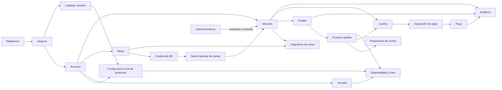

# Modelo de dominio 0.1 del SaaS operativo para restaurantes

**Estado:** borrador para validación del negocio  
**Fuente principal:** `PRD-restaurante-saas-v1.0.md`  
**Propósito:** definir conceptos, responsabilidades, relaciones y reglas del negocio antes de diseñar base de datos, API o arquitectura

## 1. Resultado principal

El dominio separa **Atención**, **Cuenta** y **Mesa**. Atención es una visita numerada de una persona o grupo expresamente asociado, con una o varias cuentas y cero mesas para Para llevar o una o más para En mesa. Mesa representa ocupación física independiente; el cierre financiero no implica salida ni liberación.

Una atención puede relacionarse con mesas, sesiones privadas de clientes, varios pedidos, cuentas divididas, preparaciones de cocina y varios pagos. Estos elementos tienen ciclos de vida independientes: entregar un plato no significa que la atención esté pagada, y confirmar un pago no significa que todos los productos hayan sido entregados.

Este documento es un modelo conceptual. Las entidades descritas no deben convertirse automáticamente en tablas ni servicios independientes.

## 2. Lenguaje del negocio

| Término | Definición |
|---|---|
| Plataforma | SaaS administrado por el proveedor y utilizado por múltiples negocios aislados. |
| Negocio | Restaurante cliente de la plataforma. Es el límite principal de aislamiento de datos. |
| Sucursal | Local operativo perteneciente a un negocio. Controla mesas, precios, disponibilidad, jornadas y caja. |
| Atención | Visita numerada de persona/grupo expresamente asociado, con varias cuentas independientes y ubicaciones según modalidad. |
| Mesa | Ubicación física de sucursal; ocupación independiente de las atenciones/cuentas que la utilizan. |
| Credencial QR | Identificador seguro y revocable de ubicación, no de persona, grupo ni cuenta. |
| Sesión de cliente | Contexto privado autorizado para consultar/operar pedidos y cuentas; no equivale a persona, dispositivo, navegador ni atención. |
| Pedido | Solicitud dentro de una atención y cuenta elegida, con origen histórico y destino vigente si es En mesa. |
| Producto pedido | Producto, menú o componente solicitado con cantidad, precio aplicado, opciones y notas. |
| Cuenta | Unidad financiera independiente dentro de atención, individual o compartida deliberadamente, con consumos, saldo, pagos y cierre propios. |
| Preparación | Seguimiento de cocina de un producto pedido o de una unidad agrupada. |
| Pago | Registro declarado/verificado/confirmado asignado a una o varias cuentas sin exceder saldos. |
| Jornada | Periodo operativo configurable, por ejemplo Almuerzo, que controla disponibilidad, producción y cierre. |
| Turno de caja | Periodo de apertura, registro y conciliación de una caja controlada. |
| Solicitud externa | Pedido inmediato o programado iniciado desde la web pública antes de convertirse en atención. |
| Merma | Producto preparado que se pierde o no puede entregarse y debe quedar registrado. |
| Alias de servicio | Nombre breve opcional, no único ni identificador, para llamar/entregar un pedido. |
| Destino de entrega | Mesa específica vigente de pedido En mesa, distinta de origen y grupo de mesas. |
| Cortesía | Producto entregado con precio aplicado cero por una decisión autorizada. |

## 3. Áreas del dominio

Las áreas siguientes representan responsabilidades del negocio. En el MVP pueden vivir dentro de un monolito modular; no implican microservicios.

| Área | Responsabilidad |
|---|---|
| Plataforma | Administración interna del SaaS, soporte auditado y aislamiento entre negocios. |
| Organización | Negocios, sucursales, configuración y activación operativa. |
| Identidad y acceso | Usuarios, membresías, roles, permisos y sucursal activa. |
| Catálogo y precios | Productos maestros, categorías, menús, opciones y configuración local. |
| Servicio | Mesas, QR, sesiones de cliente, atenciones, pedidos y responsables. |
| Cocina | Preparaciones, tablero KDS, lotes, entrega, sobrantes y mermas. |
| Cobros y caja | Cuentas, pagos, verificaciones, descuentos, devoluciones y cierres de caja. |
| Jornadas y disponibilidad | Periodos operativos, existencias por porción y disponibilidad local. |
| Pedidos externos | Solicitudes inmediatas o programadas originadas desde la web pública. |
| Auditoría y reportes | Historial inmutable, métricas operativas y reportes diarios. |

## 4. Mapa conceptual

## 5. Agregados principales

Un agregado protege reglas que deben cumplirse juntas. Las referencias entre agregados se realizan mediante identificadores; no obligan a cargar todo el sistema en una sola operación.

### 5.1 Negocio

**Raíz:** Negocio  
**Incluye:** datos comerciales básicos y estado de la relación con la plataforma.

Responsabilidades:

- Ser propietario del catálogo maestro.
- Agrupar sucursales sin mezclar información con otros negocios.
- Definir propietarios y administradores del restaurante.
- Mantener la identidad del negocio aunque cambien sus sucursales.

Reglas:

- Toda información operativa debe pertenecer a un único negocio.
- Un usuario de restaurante nunca recibe permisos internos de plataforma.
- Eliminar o desactivar una sucursal no elimina el negocio ni otras sucursales.

### 5.2 Sucursal

**Raíz:** Sucursal  
**Entidades relacionadas:** configuración operativa y medios de pago visibles.

Responsabilidades:

- Mantener datos del local y su estado operativo.
- Configurar modos de pedidos QR, caja y seguimiento de cocina.
- Definir precios, disponibilidad y productos habilitados localmente.
- Controlar si cumple las condiciones mínimas para operar.

Estados iniciales:

- **En configuración**.
- **Activa**.

Reglas:

- Solo puede activarse con responsables, catálogo con precios, jornada y configuración operativa mínima.
- Los datos históricos de una sucursal permanecen ligados a ella aunque se desactive.
- Cada sucursal administra sus precios y disponibilidad sin alterar el catálogo maestro.

### 5.3 Membresía de usuario

**Raíz:** Membresía  
**Referencias:** Usuario, Negocio, Sucursal, roles y permisos.

Responsabilidades:

- Vincular una identidad por correo con un negocio.
- Mantener roles como plantillas y permisos como autorizaciones efectivas.
- Establecer la única sucursal operativa activa del trabajador.
- Conservar el historial de traslados.

Reglas:

- Los permisos sensibles se validan individualmente en el servidor.
- Registrar pagos, verificarlos, cerrar atenciones y cerrar caja son permisos independientes.
- Un traslado cambia la sucursal activa sin reescribir operaciones anteriores.
- El propietario puede recibir capacidades operativas sin crear una segunda identidad.
- Propietarios y administradores autorizados pueden consultar varias sucursales, pero toda acción operativa se ejecuta dentro de un contexto de sucursal explícito.

### 5.4 Producto de catálogo

**Raíz:** Producto  
**Entidades:** opción estructurada y composición de menú.  
**Configuración externa:** precio y disponibilidad por sucursal.

Responsabilidades:

- Representar una identidad comercial estable mediante identificador interno y SKU opcional.
- Diferenciar producto simple y menú compuesto.
- Definir componentes y opciones permitidas.
- Permanecer consultable cuando exista historial, aunque se archive.

Reglas:

- El nombre no es una identidad única.
- Un producto utilizado no se elimina físicamente; se archiva.
- El menú se cobra una sola vez aunque sus componentes sean trazables.
- Un componente incluido puede tener precio aplicado cero sin cambiar su precio normal de catálogo.
- Cortesía e incluido en menú son motivos distintos.

### 5.4.1 Configuración local de producto

**Raíz:** Oferta de sucursal  
**Referencias:** Producto maestro y Sucursal.

Responsabilidades:

- Indicar si un producto está habilitado en una sucursal.
- Mantener su precio normal local y sus reglas de venta por separado.
- Permitir productos exclusivos sin duplicar el concepto de catálogo.
- Servir como base para la disponibilidad concreta de cada jornada.

Reglas:

- Existe como máximo una oferta activa por producto y sucursal.
- Modificar el precio local no cambia otras sucursales ni operaciones históricas.
- Archivar la oferta impide nuevas ventas en esa sucursal, pero conserva su historial.
- La disponibilidad de la jornada puede restringir una oferta habilitada, nunca habilitar un producto archivado.

### 5.5 Mesa

**Raíz:** Mesa  
**Entidad interna:** Credencial QR.  
**Referencias:** ocupación física, asociaciones activas con una o más atenciones e historial auditable de movimientos.

Responsabilidades:

- Mantener un número visible único dentro de la sucursal.
- Emitir, descargar, cancelar y reemplazar su credencial QR.
- Exponer disponibilidad según ocupación y asociaciones activas con las atenciones correspondientes.
- Conservar el historial de movimientos entre atenciones.

Reglas:

- Una mesa puede alojar varias atenciones independientes; ocupación se controla sin mezclar cuentas.
- Mover físicamente la mesa no cambia su identidad.
- Reimprimir conserva la credencial; reemplazarla invalida la anterior y genera otra.
- Cancelar un QR no elimina la mesa ni su historial.
- Agrupar/mover mesas no consolida cuentas ni transfiere consumos/pagos. Cambios autorizados de destino de pedidos no entregados dejan auditoría.
- La disponibilidad requiere confirmar que no quedan ocupantes ni atenciones activas asociadas; cerrar un contexto no libera los demás.

### 5.6 Atención

**Raíz:** Atención  
**Entidad interna:** Cuenta.  
**Referencias:** mesas, pedidos, sesiones de cliente, pagos, responsable y sucursal.

Responsabilidades:

- Mantener una identidad técnica interna desde la creación provisional, distinta del número visible asignado una sola vez al confirmarse el primer pedido válido.
- Asignar números visibles en una secuencia común En mesa/Para llevar por sucursal y día de negocio local, iniciada en 1 para nuevas atenciones elegibles; sin reinicio dentro del día ni por eventos de pedido, cuenta, mesa o caja.
- Conservar en cada atención el día de negocio de origen y su número aunque siga abierta después del corte; usar sucursal+día de origen+número para desambiguar, nunca como autorización o identidad.
- Prevenir números duplicados por reintento dentro de la sucursal y día; no prometer una secuencia legal/fiscal ni sin huecos.
- Definir la modalidad **En mesa** o **Para llevar**.
- Permitir varias cuentas individuales o compartidas deliberadamente; no exige una atención por persona.
- Coordinar responsable principal y colaboración de otros mozos.
- Agrupar pedidos, consumos, cuentas y pagos sin confundir sus estados.
- Decidir si cumple las condiciones de cierre.

Estados iniciales:

- **Provisional:** creada por un escaneo, todavía sin pedido válido; conserva una identidad interna, pero no consume ni muestra un número de la secuencia.
- **Activa:** posee al menos un pedido válido confirmado o fue abierta por personal autorizado; el número visible se asigna una sola vez al confirmar el primer pedido válido.
- **Cerrada:** pedidos resueltos, saldo cero confirmado y sin pagos por verificar.
- **Expirada:** provisional abandonada sin actividad; no genera venta ni ocupa permanentemente una mesa.

Reglas:

- Una atención En mesa tiene destino de servicio y puede coexistir con otras atenciones en la misma mesa; Para llevar no ocupa mesa.
- Una atención Para llevar tiene número de retiro y no ocupa mesa.
- Puede asociar/cambiar mesas sin consolidar cuentas ni reasignar consumos o pagos.
- El cierre exige pedidos resueltos, todas las cuentas cerradas con saldo cero y sin pagos inciertos; no libera físicamente ubicaciones ocupadas por otros.
- Una atención cerrada no se reabre ni se elimina.
- Atención cerrada no se reabre ni admite pedidos. Si la visita sigue abierta tras cerrar una cuenta, nuevos consumos requieren otra cuenta abierta.
- Correcciones y devoluciones posteriores se vinculan con el registro original.
- Alias opcional, modificable y no único no sustituye referencias ni autoriza acceso. La secuencia común En mesa/Para llevar se asigna al confirmar el primer pedido válido y se delimita por sucursal y día de negocio local; el corte se configura según horario del restaurante, sin hora predeterminada.
- Entregar todos los productos no implica cerrar la atención.
- Confirmar el pago completo no permite cerrar si existen pedidos sin resolver.

### 5.7 Sesión privada de cliente

**Raíz:** Sesión de cliente  
**Referencias:** Atención, mesa inicial y pedidos creados.

Responsabilidades:

- Representar contexto privado autorizado, sin equiparar persona con dispositivo/navegador.
- Limitar la visibilidad a su carrito, pedidos, estados y saldo propio.
- Mantener el vínculo con la atención aunque las mesas se unan o se muevan.
- Registrar la intención **Ya pagué** sin confirmar dinero automáticamente.

Reglas:

- Una sesión opera solo contextos abiertos explícitamente autorizados; escanear mesa no une cuentas.
- No puede consultar productos, subtotales ni saldos de otras sesiones.
- Sus pagos iniciados solo se asignan a su saldo propio.
- No puede asignarse una mesa escribiendo un número desde la web pública.
- Cerrar cuenta/atención impide publicar en ese contexto cerrado; otros contextos abiertos autorizados permanecen disponibles.
- La credencial QR identifica ubicación; la sesión identifica contexto autorizado, no persona, cuenta ni navegador. La asociación a otra atención/cuenta es explícita y autorizada.
- Asociación a otra atención/cuenta requiere acción explícita autorizada; no revela datos de terceros.

### 5.8 Pedido

**Raíz:** Pedido  
**Entidades:** Producto pedido, opciones, componentes aplicados y notas.  
**Referencias:** Atención, autor, origen y confirmador.

Responsabilidades:

- Registrar una solicitud concreta enviada por mozo, cliente QR o web pública.
- Conservar por separado origen histórico, grupo de mesas y destino físico vigente.
- Conservar precios aplicados y composición como fotografía histórica.
- Controlar aprobación y envío a cocina.
- Evitar que un reintento cree un pedido duplicado.

Estados de admisión:

- **Borrador:** todavía editable y no enviado.
- **Pendiente de aprobación:** espera decisión del mozo según la política de la sucursal.
- **Aprobado:** puede generar trabajo de cocina.
- **Rechazado:** no llegará a cocina y conserva el motivo.
- **Anulado:** fue retirado mediante una acción autorizada y auditable.

Reglas:

- Cada pedido conserva origen, creador, fecha y, cuando corresponda, confirmador.
- Cada pedido En mesa tiene mesa destino concreta y alias opcional. Cambio autorizado de destino no entregado conserva anterior/nuevo/actor/momento, sin reescribir pedido entregado ni finanzas.
- Un pedido pendiente de aprobación no genera preparación.
- El precio aplicado no cambia si luego se modifica el catálogo.
- Una nota libre no cambia el precio.
- Opciones estructuradas sí pueden cambiar precio o disponibilidad.
- Los reintentos utilizan una identidad de operación estable para producir un único resultado.

### 5.9 Producto pedido

**Entidad dentro de Pedido.**

Responsabilidades:

- Conservar producto, nombre mostrado, cantidad y precio aplicados.
- Registrar si pertenece a un menú y qué componentes incluye.
- Vincularse con una cuenta y con su preparación de cocina.
- Registrar descuentos, cortesías, anulaciones y mermas sin perder el original.

Reglas:

- El importe nunca se reconstruye únicamente desde el catálogo vigente.
- Un componente incluido en menú se registra con motivo **Incluido en menú**.
- Una cortesía exige motivo y autorizador.
- Si la preparación ya comenzó, una anulación no borra el producto y puede generar merma.

### 5.10 Preparación de cocina

**Raíz:** Preparación  
**Referencias:** Producto pedido, atención, sucursal y responsable de entrega.

Responsabilidades:

- Proyectar el trabajo aprobado hacia el KDS.
- Registrar el avance sin alterar el estado financiero.
- Permitir seguimiento por producto o por componentes cuando la sucursal lo active.
- Coordinar toma y entrega sin duplicación.

Estados mínimos:

- **Pendiente**.
- **En preparación**.
- **Listo**.
- **Entregado**.
- **Anulado**, cuando corresponda.

Reglas:

- Solo productos de pedidos aprobados aparecen en cocina.
- Marcar listo no significa entregado.
- Marcar entregado retira el elemento del tablero activo, no lo elimina del historial.
- Solo una persona puede adjudicarse la entrega activa.
- Entregar no libera mesas ni modifica pagos.

### 5.11 Cuenta

**Entidad financiera dentro de Atención.**

Responsabilidades:

- Agrupar consumos para cobrar toda la atención o dividirla.
- Permitir división por comensal, productos o monto.
- Mantener total, monto confirmado y saldo pendiente.
- Recibir asignaciones de pagos sin duplicar importes.

Reglas:

- Toda atención activa posee al menos una cuenta predeterminada.
- Todo consumo debe quedar asignado y contabilizado en una cuenta; no se puede cerrar una cuenta omitiendo consumos sin asignación.
- La suma asignada entre cuentas no puede exceder el total de los consumos.
- Un producto no puede cobrarse dos veces.
- Dividir la cuenta no altera pedidos ni preparaciones.
- Una cuenta solo puede cerrarse cuando todos sus productos vinculados fueron entregados o cancelados correctamente, su saldo confirmado es cero, no tiene pagos pendientes o sin verificar y todos sus consumos están contabilizados.
- La cuenta cerrada no recibe consumo; si la atención sigue abierta, puede continuarse en otra cuenta abierta. Las asignaciones y pagos confirmados permanecen inmutables y auditables.
- El saldo solo disminuye por pagos confirmados.
- El cliente ve solo los consumos y saldos de sus contextos explícitamente autorizados; mesa, alias o grupo no habilitan divulgación automática. El personal accede al detalle según los permisos existentes.
- Cobro conjunto puede asignarse a cuentas originales sin fusionar deudas automáticamente; divisiones/fusiones deliberadas mantienen trazabilidad/auditoría.

### 5.12 Pago

**Raíz:** Pago  
**Entidades relacionadas:** asignaciones, verificación y devolución.

Responsabilidades:

- Registrar efectivo, Yape, Plin o tarjeta externa.
- Controlar intención, verificación y confirmación.
- Distribuir un pago entre una o varias cuentas sin superar el saldo.
- Conservar correcciones y devoluciones como movimientos vinculados.

Estados:

- **Pendiente**.
- **Por verificar**.
- **Confirmado**.
- **Fallido**.

Reglas:

- **Ya pagué** crea o actualiza una intención Por verificar; no reduce el saldo.
- Solo un usuario con permiso confirma un pago verificable.
- Un reintento con la misma identidad no crea otro cobro.
- Un pago confirmado no se borra ni vuelve silenciosamente a Pendiente.
- Una devolución es un movimiento nuevo vinculado con el pago original.
- La suma confirmada no puede superar el saldo asignado.
- Una captura de pantalla no es evidencia suficiente por sí sola.

### 5.13 Jornada

**Raíz:** Jornada  
**Entidades:** disponibilidad local, lote de producción, sobrante y merma.

Responsabilidades:

- Representar el servicio operativo de una sucursal, inicialmente Almuerzo.
- Controlar disponibilidad por producto durante el periodo.
- Aceptar varios lotes de producción.
- Consolidar vendidos, sobrantes y mermas al cierre.

Estados iniciales:

- **Borrador**.
- **Activa**.
- **Cerrada**.

Reglas:

- Una jornada pertenece a una sucursal.
- Agregar un lote aumenta la cantidad disponible sin crear otra jornada.
- **Agotado** impide nuevos pedidos, pero no modifica pedidos existentes.
- Cerrar la jornada no cierra automáticamente atenciones ni caja.
- La planificación semanal futura no reemplazará la confirmación de lo realmente preparado.

### 5.14 Turno de caja

**Raíz:** Turno de caja  
**Referencias:** sucursal, responsable y pagos confirmados.

Responsabilidades:

- Registrar apertura y monto inicial en modo controlado.
- Consolidar movimientos por medio de pago.
- Conciliar diferencias con motivo y auditoría.
- Bloquear el cierre mientras existan operaciones sin resolver.

Reglas:

- Cerrar una atención y cerrar caja son operaciones distintas.
- Un usuario puede cerrar atenciones sin poseer permiso de cierre de caja.
- No puede cerrarse con atenciones abiertas ni pagos Por verificar.
- El modo simple registra pagos, pero no exige arqueo.

### 5.15 Solicitud externa de pedido

**Raíz:** Solicitud externa  
**Entidades:** productos solicitados y ventana de retiro.  
**Origen:** web pública.

Responsabilidades:

- Representar una intención de compra antes de incorporarla a la operación.
- Diferenciar retiro inmediato y programado.
- Permitir que un mozo autorizado la tome, revise, acepte o rechace.
- Conservar responsable, motivo y tiempo de respuesta.

Estados:

- **Pendiente**.
- **Tomada**.
- **Aceptada**.
- **Rechazada**.
- **Convertida**.
- **Cancelada**.

Reglas:

- Una solicitud no aceptada no llega a cocina.
- Aceptar una solicitud inmediata crea una atención Para llevar y su número de retiro.
- Una solicitud programada aceptada conserva su fecha y se convierte en atención al activarse para preparación o cuando el cliente llega, según la modalidad confirmada.
- Una solicitud para posible consumo En mesa no reserva ni bloquea mesa.
- Rechazar exige motivo.
- Convertir es idempotente: una solicitud solo puede originar una atención.

### 5.16 Importación de catálogo

**Raíz:** Lote de importación.

Responsabilidades:

- Validar Excel o CSV sin modificar inmediatamente el catálogo.
- Presentar una vista previa de altas, cambios, archivos y rechazos.
- Aplicar los cambios una sola vez después de confirmación autorizada.
- Conservar errores, auditoría y una versión recuperable anterior.

Reglas:

- Un lote inválido no cambia el catálogo.
- Cada error identifica fila, campo y motivo.
- La actualización usa identificador interno o SKU, nunca solo el nombre.
- Una importación confirmada no puede aplicarse otra vez por reintento.

## 6. Objetos de valor

Los objetos de valor no tienen identidad propia; se comparan por su contenido y validan reglas comunes.

| Objeto | Contenido y regla principal |
|---|---|
| Identificador de negocio | Valor opaco que define el límite de aislamiento. |
| Dinero | Importe y moneda; no permite operaciones entre monedas distintas sin conversión explícita. |
| Cantidad | Valor positivo con unidad aplicable. |
| Número de atención | Secuencia común En mesa/Para llevar por sucursal y día de negocio local; se asigna al confirmar el primer pedido válido y permanece estable durante la visita. |
| Número de retiro | Identificador visible para una atención Para llevar. |
| Código de mesa | Número visible único dentro de la sucursal. |
| Credencial QR | Token no predecible con estado Activa o Cancelada. |
| Origen de pedido | Mozo, Cliente por QR o Web pública. |
| Modalidad de atención | En mesa o Para llevar. |
| Motivo auditado | Código o texto obligatorio acompañado de actor y fecha. |
| Ventana de retiro | Fecha, hora y tolerancia para un pedido programado. |
| Clave de idempotencia | Identidad de una operación reintentable; repetirla produce el mismo resultado. |
| Referencia de pago | Dato externo opcional que apoya la verificación sin sustituirla. |
| Alias de servicio | Texto opcional, no único, no prueba identidad ni autoriza. |
| Destino de entrega | Mesa específica del pedido En mesa, actualizable con auditoría antes de entregar. |
| Precio aplicado | Importe histórico más motivo: normal, incluido, cortesía o descuento. |

## 7. Reglas invariantes del sistema

Estas reglas deben cumplirse aunque existan concurrencia, reintentos o varios dispositivos:

1. Un dato operativo pertenece a un solo negocio y una sola sucursal, salvo configuración explícitamente maestra del negocio.
2. Una mesa puede alojar atenciones independientes simultáneas; ocupación física y finanzas se administran por separado.
3. Una atención cerrada no se reabre ni se elimina.
4. Un QR cancelado no crea nuevas sesiones ni pedidos.
5. Sesión opera solo contextos autorizados; mesa/dispositivo no unen personas ni revelan consumos ajenos.
6. Un pedido pendiente de aprobación no genera trabajo de cocina.
7. El precio histórico de un producto pedido no cambia con el catálogo.
8. Preparación, entrega, pago y cierre mantienen estados independientes.
9. Un producto, pago, entrega o conversión no puede duplicarse por reintentos.
10. Solo pagos confirmados reducen el saldo.
11. Los pagos confirmados no superan el saldo de sus asignaciones.
12. Cerrar cuenta exige pedidos asignados resueltos, saldo cero y sin pagos pendientes; atención requiere además todas las cuentas cerradas.
13. Cierre financiero y liberación física son distintos; personal confirma vacancia y entrega no libera por sí sola.
14. Cerrar caja exige que no existan atenciones ni pagos sin resolver.
15. Correcciones financieras y devoluciones preservan el movimiento original.
16. Acciones sensibles conservan actor, fecha, motivo y sucursal.
17. Cuenta cerrada no admite consumo; cerrar una cuenta no invalida otros contextos autorizados abiertos.
18. Atención cerrada no se reabre ni admite pedidos; sesiones no publican allí.
19. Pedido En mesa conserva destino específico, alias opcional y auditoría de cambios no entregados.

## 8. Servicios de dominio

Se utilizan cuando una regla involucra varios agregados y no pertenece naturalmente a uno solo.

| Servicio conceptual | Responsabilidad |
|---|---|
| Ocupación física | Mantener varias atenciones por ubicación y confirmar disponibilidad independiente del cierre financiero. |
| Política de admisión de pedidos | Resolver si un pedido requiere aprobación, primera aprobación o paso directo. |
| Calculador de precios | Determinar precio aplicado, menú, opciones, descuentos y cortesías. |
| Asignador de cuentas | Dividir consumos por persona, producto o monto sin duplicarlos. |
| Aplicador de pagos | Asignar pagos confirmados y evitar exceder saldos. |
| Política de cierre de atención | Comprobar pedidos, saldo y pagos inciertos antes de cerrar. |
| Control de disponibilidad | Autorizar productos según jornada, cantidad y agotados. |
| Conversor de solicitud externa | Crear exactamente una atención desde una solicitud aceptada. |
| Coordinador de entrega | Conceder la toma exclusiva de un pedido listo y registrar la entrega. |

## 9. Eventos del dominio

Los eventos expresan hechos ya ocurridos. Facilitan auditoría, notificaciones y actualización de vistas sin mezclar responsabilidades.

- Negocio creado.
- Sucursal activada.
- Usuario trasladado de sucursal.
- Credencial QR emitida.
- Credencial QR cancelada.
- Atención creada.
- Atención activada.
- Mesa asignada a atención.
- Mesa liberada de atención.
- Cuenta cerrada.
- Destino de entrega actualizado.
- Ocupación física liberada por personal autorizado.
- Sesión de cliente iniciada.
- Pedido enviado.
- Pedido aprobado.
- Pedido rechazado.
- Preparación iniciada.
- Preparación marcada lista.
- Entrega adjudicada.
- Producto entregado.
- Pago declarado.
- Pago enviado a verificación.
- Pago confirmado.
- Pago fallido.
- Devolución registrada.
- Atención cerrada.
- Jornada abierta.
- Lote de producción agregado.
- Producto agotado.
- Jornada cerrada.
- Solicitud externa aceptada.
- Solicitud externa convertida en atención.
- Turno de caja cerrado.

## 10. Vistas derivadas

Estas vistas se calculan desde los agregados; no son fuentes independientes de verdad.

| Vista | Información |
|---|---|
| Mapa de mesas | Ocupación física y atenciones/cuentas asociadas por ubicación sin consolidación. |
| Bandeja de pedidos QR | Pedidos pendientes de aprobación por sucursal. |
| Bandeja web pública | Solicitudes pendientes, responsable y tiempo de espera. |
| Tablero KDS | Preparaciones activas agrupadas por estado. |
| Bandeja de entrega | Productos listos, responsable original y persona que se encarga. |
| Vista KDS/servicio | Referencias atención/pedido, destino específico o retiro, alias opcional, origen histórico y estado. |
| Cuenta del cliente QR | Solo contextos autorizados, nunca terceros por compartir mesa/dispositivo. |
| Cuenta operativa | Atención completa, divisiones, pagos y saldo para personal autorizado. |
| Resumen de jornada | Producción, ventas, sobrantes y mermas. |
| Cierre de caja | Totales confirmados por medio y diferencias. |
| Reporte diario | Ventas, atenciones, ticket promedio, anulaciones, cortesías y mermas. |
| Constancia de consumo | Atención, productos, totales, pagos y fecha, sin valor tributario. |

## 11. Autoridad y auditoría

Cada acción sensible registra:

- Negocio y sucursal.
- Usuario o sesión que originó la acción.
- Usuario que la autorizó o confirmó, cuando sea distinto.
- Fecha y hora.
- Motivo obligatorio cuando corresponda.
- Identidad de operación para detectar reintentos.
- Valores anteriores y nuevos cuando exista una corrección.

Nunca se borran silenciosamente pagos, devoluciones, anulaciones, cierres, traslados, importaciones ni cambios de credenciales QR.

## 12. Decisiones de modelado

1. **Atención, Cuenta y Pedido son distintos.** Una visita recibe pedidos sucesivos y varias cuentas independientes.
2. **Pedido y Preparación son distintos.** Cocina puede procesar productos de un pedido a ritmos diferentes.
3. **Atención y Cuenta son distintas.** Dividir pagos no divide la operación ni duplica pedidos.
4. **Pago y confirmación son distintos.** Una declaración del cliente no constituye dinero confirmado.
5. **Mesa y ocupación son distintas.** Puede alojar varias atenciones y no se libera por cierre financiero.
6. **QR, sesión y persona son distintos.** QR identifica ubicación; asociación a otro contexto es explícita y autorizada.
7. **Catálogo y producto pedido son distintos.** El pedido conserva una fotografía histórica.
8. **Jornada y lote son distintos.** Preparar más comida aumenta disponibilidad dentro de la misma jornada.
9. **Solicitud externa y atención son distintas.** La solicitud debe aceptarse y convertirse exactamente una vez.
10. **Cierre de atención y cierre de caja son distintos.** Sus permisos y condiciones no se mezclan.
11. **Origen, agrupación y destino son distintos.** Cambiar destino no reescribe pedidos entregados ni cambia cuenta o pago.

## 13. Aspectos todavía no diseñados

Este documento no decide:

- Tablas, claves o índices de base de datos.
- Endpoints, contratos HTTP ni webhooks.
- Frameworks, lenguajes, proveedores de nube o infraestructura.
- División física en servicios.
- Interfaces y prototipos visuales.
- Secuencia completa de cada máquina de estados.
- Facturación electrónica, delivery o inventario avanzado.
- Implementación técnica de la numeración aprobada: identidad interna, asignación idempotente al primer pedido válido confirmado, unicidad por sucursal y día de negocio, y conservación del día de origen al cruzar el corte. No implica una decisión de esquema o tecnología.

## 14. Validaciones para aprobar el modelo

- La atención representa correctamente a una persona o grupo sin depender de una mesa fija.
- Varias atenciones coexisten en mesa sin compartir cuentas ni datos privados.
- Cuenta liquidada no recibe nuevo consumo; atención abierta continúa en otra cuenta.
- Alias opcional ayuda al servicio sin ser identidad ni autorización.
- Pedido En mesa muestra destino específico; cambio auditado no afecta finanzas.
- Los pedidos sucesivos no crean atenciones nuevas por accidente.
- Las cuentas divididas no duplican productos ni pagos.
- La privacidad de cada sesión QR permanece separada de la vista completa del personal.
- Cocina puede avanzar independientemente del pago.
- La atención solo cierra cuando operación y finanzas están resueltas.
- Los pedidos inmediatos y programados pueden entrar desde la web pública sin reservar mesas.
- La disponibilidad pertenece a la sucursal y a la jornada.
- El modelo permite varias sucursales sin mezclar precios ni operación.
- Los reintentos no crean pedidos, pagos, entregas o conversiones duplicadas.

## 15. Referencias

- PRD aprobado: `PRD-restaurante-saas-v1.0.md`.
- Toast Developer Guide, modelo Order, Check y MenuItemSelection: https://doc.toasttab.com/doc/devguide/apiOrdersOrderObjectSummary.html
- Square Developer Documentation, idempotencia: https://developer.squareup.com/docs/build-basics/common-api-patterns/idempotency
- Square documenta una regla específica de reinicio de números de ticket por horario configurado o umbral. Toast distingue identificadores de orden, cuenta y selección, pero no demuestra el corte de día de negocio de esta política. Lightspeed L-Series describe secuencias de impresión y Oracle Simphony secuencias de cuentas por centro de ingresos. Son comportamientos concretos, no un estándar ni equivalencias con Atención. Nuestra adaptación aprobada es una secuencia común En mesa/Para llevar por sucursal y día de negocio local, asignada al confirmar el primer pedido válido, sin ciclos intradía ni hora predeterminada. [Square](https://squareup.com/us/en/release-notes/release-notes-may-21st), [Toast: identificadores](https://doc.toasttab.com/doc/devguide/apiOrdersOrderObjectSummary.html), [Lightspeed](https://resto-support.lightspeedhq.com/hc/en-us/articles/360035363894-Advanced-printer-template-settings), [Oracle Simphony](https://docs.oracle.com/en/industries/food-beverage/simphony/19.7/simcg/c_transactions_check_numbers.htm).
- El corte del día de negocio es independiente del turno y cierre de caja; cerrar caja no reinicia ni modifica la secuencia de atenciones.

## 16. Siguiente paso recomendado

Validar este vocabulario y las fronteras de los agregados con los flujos reales del restaurante. Después se documentarán las máquinas de estados de Atención, Pedido, Preparación, Pago, Jornada y Solicitud externa antes de diseñar la experiencia de usuario o la arquitectura técnica.
