# Auditoría de UI/UX — sistema completo (POS de restaurante)

Auditoría **en vivo + de código** sobre la app que se sirve en `http://localhost:3000`
(API en `:8000`), en el worktree `audit/ui-ux` creado desde `7581247`.

- **Cobertura real:** **131 visitas de pantalla** (24 rutas × 4 roles × 3 viewports,
  más pantallas públicas y rutas prohibidas), **12/12 logins correctos**, captura de pantalla,
  métricas de layout y escaneo **axe-core** en cada visita; más 4 auditorías estáticas
  paralelas (sistema de diseño, accesibilidad WCAG 2.2 AA, arquitectura de información/copy,
  responsive/táctil) y una pasada de interacción sobre los diálogos y el flujo de cobro.
- **Entregable de código:** arnés reutilizable en `frontend/e2e/audit/` (`capture.mjs`,
  `flows.mjs`, `analyze.mjs`, `lib.mjs`, `run-audit.ps1`). Se puede volver a correr para
  medir cualquier cambio.

---

## Veredicto en 30 segundos

| Pregunta | Respuesta |
|---|---|
| ¿El flujo núcleo se puede operar? | **Sí.** Salón → pedido → cocina → cobro funciona y el cobro táctil (`CobrarDialog`) está muy bien resuelto. |
| ¿Se puede entregar la UI así? | **No sin resolver 3 P0**: los estados vacíos falsos en pantallas operativas, el doble camino de dinero sobre una misma cuenta y el modal de cobro sin comportamiento de modal. |
| ¿Es accesible? | **No.** 428 nodos infractores en 131 visitas; el zoom está bloqueado por `<meta viewport>` en **las 131 visitas**, hay **96 botones sin nombre accesible** en 18 pantallas y **61 nodos con contraste insuficiente**. |
| ¿Es coherente el diseño? | **No.** Conviven **tres sistemas de diseño**: el sistema real ("Fresco", azul, tokens HSL), los hex de `design_guidelines.md` incrustados a mano en el Salón, y una hoja de 817 líneas propia del cobro. Dos documentos describen sistemas muertos. |
| ¿Se sostiene en móvil/tablet? | **Parcialmente.** Salón desborda 19 px en tablet, el diálogo genérico no cabe en pantallas de 390 px de alto, y Productos móvil acumula 30 violaciones de accesibilidad y 51 controles pequeños. |
| ¿Los estados se leen de un vistazo? | **No del todo.** "Listo", "Entregado" y "Pagado" son **el mismo color** (`index.css:172/174/178`) y el CSS de los badges tiene una declaración inválida que descarta el color del texto. |
| ¿Los datos acompañan? | **No.** El salón muestra ~90 mesas, casi todas de pruebas E2E (`9xxxx`), y la carta pública dice "Carta E2E 1791715566339" con 3 combos "Test". |

---

> **Nota sobre las cifras:** las tablas de este informe describen el estado **baseline** (la
> primera corrida de 131 visitas). Después de los arreglos P0/P1 y de la **ronda 1** del objetivo
> (sección correspondiente), el subconjunto comparable de **49 visitas** mide **0 violaciones de
> axe-core** y CLS máximo **0,56**. El arnés permite repetir la medición en cualquier momento:
> `node frontend/e2e/audit/compare.mjs`.

---

## Cómo se auditó (y qué límites tiene)

**Método.** Se lanzó un Chromium headless controlado por CDP (el sandbox de este entorno bloquea
los *named pipes* de Node, ver anexo) y se recorrieron, por cada rol y viewport
(**1440×900 escritorio, 1024×768 tablet, 390×844 móvil**), todas las rutas alcanzables.
En cada visita se registró: captura completa, errores de consola y de JS, peticiones ≥400,
métricas de layout (desbordamiento, objetivos táctiles, texto <12 px, texto recortado,
nombres accesibles, etiquetas, encabezados, landmarks), rendimiento (FCP, CLS, *long tasks*,
nodos DOM) y un escaneo **axe-core** (WCAG 2.0/2.1 A+AA y buenas prácticas).

**Qué NO cubre.** No se midió con lector de pantalla real ni con teclado físico sobre hardware
real; no se probó iOS/Safari (solo Chromium); no se auditaron los mensajes de WhatsApp/impresión
física; y la auditoría de dinero es de UI (los bugs de cálculo ya están en
`docs/delivery-readiness-audit.md`).

**Incidencias del entorno que afectan a la evidencia** (importante para leer las tablas):
- El checkout principal recibió **commits nuevos durante la auditoría** (`7581247` → `585a675`) y
  se crearon pedidos nuevos mientras corría. El worktree auditado quedó fijado en `7581247`.
- Entre las 04:08 y las 04:09 UTC el backend dejó de aceptar conexiones (~10 s): se ven
  `net::ERR_CONNECTION_REFUSED` y un pedido borrado a mitad de corrida devolvió `404`
  en `/pedidos/:id`. **No son defectos del producto** y están identificados uno por uno;
  además esa caída destapó el P0-1 (la UI no distingue "error" de "vacío").
- Los 122 `net::ERR_ABORTED` de `/api/notifications/stream` son el cierre normal del stream
  al navegar, no un fallo del SSE.
- La pasada de interacción **no pudo abrir un cobro real**: en ese momento las dos cuentas
  existentes estaban ya pagadas ("Pagado · sigue en cocina"), así que se recorrieron Caja,
  los diálogos de administración, el carrito público y el login, pero no el `CobrarDialog` en
  vivo. Los P0-2 y P0-3 se sostienen en la lectura del código y en la auditoría estática de
  accesibilidad, y así se declaran.
- Una comprobación aislada (login del cajero en móvil) **falló por un *flake* de la
  automatización** y se repitió después con éxito: no es un defecto del producto y no se reporta.
- Un `404` en `/pedidos/:id` corresponde a un pedido borrado mientras corría la auditoría
  (había actividad concurrente en la base), no a un fallo de la pantalla.

---

## 🔴 P0 — bloqueantes

### P0-1. Un fallo de red se ve igual que "no hay nada": el pase de cocina y el salón quedan vacíos

En las pantallas que sostienen la operación, el estado de error **no existe**: si la API falla,
la UI pinta su estado vacío.

- `pages/Cocina.jsx:126-130` usa `usePolling(...)` y **descarta `error` y `loading`**; `:239-240`
  pinta `Vacío` en cada columna cuando `col.cards.length === 0`. Las 4 columnas en "Vacío" son
  idénticas a un servicio terminado.
- `pages/Salon.jsx:89-98` (mismo patrón) y `:391` → `No hay mesas con esos filtros.`
- `hooks/usePolling.js:39` **sí** expone `{ error, loading, tick, refetch }`: el dato está y no se usa.

**Evidencia en vivo.** En la visita `mobile/admin/salon` se registraron **12 peticiones fallidas**
(`/orders`, `/tables`, `/branches`, `/restaurants/current`, `/orders/kitchen`) y **18 errores de
consola**, y aun así la pantalla no mostró ningún aviso de error: el mozo ve una sala vacía y
el cocinero, un pase vacío. En hora punta eso significa **no cocinar**.

**Otros consumidores del mismo antipatrón:** `pages/Productos.jsx:230-236` (sin `catch`),
`pages/Local.jsx:105-108`, `pages/Caja.jsx:87` (`.catch(() => setItems([]))`),
`pages/Comprobantes.jsx:118-120`, `pages/Configuracion.jsx:101,143,279` (si falla queda
"Cargando…" para siempre).

### P0-2. La misma cuenta ofrece dos acciones de dinero simultáneas (Confirmar y Cobrar)

- `pages/Caja.jsx:637-644` — `webPending` incluye los pedidos de la carta web con
  `payment_status !== 'confirmado'` y los pinta con un botón **Confirmar** (`:65-66`) que solo
  marca `payment_status="confirmado"` **sin registrar pago** (`POST /orders/{id}/confirm-payment`).
- `pages/Caja.jsx:618-626` — `cobrables` (y por tanto `requestedBills` / `otherBills`, `:628-629`)
  **no excluye** esos mismos pedidos: aparecen otra vez con el botón **Cobrar** (`:743`, `:768`),
  que sí abre `CobrarDialog` y registra un pago real.
- Un pedido web con `payment_status="comprobante_subido"` (el cliente ya subió su captura de
  Yape/Plin, `backend/routes/public.py:779-783`) cae en **las dos listas a la vez**, en la misma
  pantalla y sin ningún aviso ni exclusión mutua.

**Escenario real.** El cliente paga por Yape desde la mesa y sube la captura. El cajero ve el
pedido en dos bloques, pulsa *Cobrar* y registra efectivo: el cliente pagó dos veces y el arqueo
de caja queda descuadrado. El servidor solo bloquea el segundo pago **después** de que
`payment_status` sea `confirmado` o `pagado` (`backend/routes/payments.py:97`); en el momento de
la decisión, la UI no ayuda. (El diálogo de cobro **sí** avisa cuando la cuenta trae un
comprobante pendiente — `CobrarDialog.jsx:885-890` —, pero la lista de Caja ofrece además un
segundo camino de dinero para esa misma cuenta.)

### P0-3. El diálogo de cobro no se comporta como modal (foco, `aria-modal` y Escape)

- `components/CobrarDialog.jsx:474-475`: `<div className="cobro-overlay">` + `role="dialog"` **sin
  `aria-modal`**; sus subdiálogos sí lo llevan (`:993, :1026, :1047, :1066`).
- `:142-160` es el **único** manejador `keydown` y solo atiende los dígitos 1-5: **Escape no cierra**.
- `styles/cobro.css:23-31`: overlay `position: fixed; z-index: 80` sin `inert`/`aria-hidden` en el fondo.
- No hay foco inicial ni trampa de foco: al abrir, el foco sigue en el botón "Cobrar" del listado,
  que queda **detrás** del overlay.

**Quién queda fuera:** el cajero que trabaja con teclado (o con lector de pantalla) no puede
completar un cobro: tabula por decenas de elementos invisibles. Es el único modal artesanal del
sistema; el resto usa Radix (`ui/dialog.jsx`), que ya resuelve foco, Escape y retorno de foco.

---

## 🟠 P1 — fricción grave (resolver en la primera semana)

| # | Hallazgo | Evidencia | Medición / impacto |
|---|---|---|---|
| 1 | **El zoom está deshabilitado en toda la app** | `public/index.html:5` (`maximum-scale=1`) | axe `meta-viewport` en **131/131 visitas**; en Android el personal no puede ampliar un ticket ni un precio |
| 2 | **96 botones sin nombre accesible** | `AppShell.jsx:147` (hamburguesa), `Productos.jsx:420,421,501`, `Local.jsx:180,181`, `Usuarios.jsx:112`, `Categorias.jsx:60,61`, `PedidoNuevo.jsx:217,219`, `CartPanel.jsx:78,80,124,128,130`, `Checkout.jsx:441,446`, `Login.jsx:113` | axe `button-name` (crítico) en 18 pantallas; `productos@mobile` = 29 en una sola pantalla |
| 3 | **El diálogo genérico no cabe en pantallas bajas** | `components/ui/dialog.jsx:32` y `alert-dialog.jsx:30`: sin `max-h` ni `overflow-y-auto`, centrado con `translate-y-[-50%]`; Radix bloquea el scroll del fondo | En 390×844 o 844×390 el botón **Guardar** de `Usuarios.jsx:131-191`, `Local.jsx:382-457` y `Caja.jsx:491-525` queda fuera de pantalla y no hay forma de llegar |
| 4 | **La leyenda de estados desborda el tablet y no existe en móvil** | `Salon.jsx:376`: `hidden lg:flex` con 8 chips; `:364` sin `flex-wrap` | Desbordamiento horizontal de página de **19 px** en `salon` y `dashboard` a 1024 px (4 visitas); en móvil desaparece la única clave de colores |
| 5 | **"Listo", "Entregado" y "Pagado" son el mismo color** | `index.css:172` ≡ `:174` ≡ `:178` (`--green-soft`/`--green` idénticos) | El mozo no distingue "hay que retirar" de "ya se cobró"; incumple `design_guidelines.md:57` |
| 6 | **El color del texto de los badges no se aplica (declaración CSS inválida)** | `index.css:169-180` usa `color: var(--green)` / `var(--warn)`, pero `:74,76` los definen como tripletes HSL sueltos (`--warn: 30 85% 50%`) | La declaración se descarta y el texto hereda el color base; si se "arregla" envolviéndola en `hsl()` quedaría en **2,70:1** y **2,36:1** (por debajo de AA) |
| 7 | **61 nodos con contraste insuficiente** | `Salon.jsx:447,458,469,480,491` (botones con `text-white` sobre `s.dot`); `Salon.jsx:42` (`#71717A` sobre `#EFEFEF`) | axe `color-contrast` (serio); medido: blanco/`#E07A5F` = **2,95:1**, blanco/`#14B8A6` = **2,49:1**, chip de cuenta **3,66:1** (`#a96441` sobre `#ffe0cc`); los pares *badge* sí pasan (6,15–9,85:1) |
| 8 | **La carta pública pide un endpoint autenticado y falla 2 veces por visita** | `contexts/ThemeContext.jsx:39` y `hooks/useRestaurantFeatures.js:20` llaman `/restaurants/current` sin sesión | **401 sistemático en las 18 visitas públicas** (`restaurants/current`) y error en consola; además el tema configurado del restaurante **nunca se aplica en la carta pública** (cae al `catch`) |
| 9 | **CLS altísimo en la carta pública** | `pages/Landing.jsx` / `components/ProductCard.jsx:34-37`: la grilla aparece tras la respuesta, sin espacio reservado | CLS **0,85** (`landing@mobile`), 0,84 (`menu@tablet`), 0,73 (`landing@desktop`), **0,56 en `salon@desktop`**; >0,25 ya es "pobre": el contenido salta bajo el dedo del cliente que agrega al carrito |
| 10 | **Objetivos táctiles diminutos en las acciones críticas** | `ui/dialog.jsx:37-41` y `ui/sheet.jsx:50-53` (cerrar 16×16 px), `Salon.jsx:447-491` (`h-9` = 36 px), `Checkout.jsx:441,446` (`h-7 w-7` = 28 px), `Caja.jsx:65,66,212` (`h-8`), `RoleInbox.jsx:76`/`ThemeToggle.jsx:13` (36 px) | **2.900 mediciones <44 px** en 131 visitas (85 por debajo de 24 px); `productos@mobile` 51, `usuarios@mobile` 25 |
| 11 | **Navegación ambigua y menú que se reemplaza** | `components/AppShell.jsx:30-34`: `/pedidos` y `/cocina` aparecen dos veces; `:62-79` reemplaza el array cuando el usuario combina funciones y **pierde "Pedidos"**; etiquetas "Hoy/Gestión", "Carta", "Agotar", "Equipo", "Casa" | Un admin multifunción no ve el historial de pedidos; tres nombres para la misma sección (`AppShell.jsx:69` vs `:22` vs `Dashboard.jsx:184`) |
| 12 | **La carta pública muestra datos de prueba y placeholders rotos** | `ProductCard.jsx:37,112`: si no hay imagen se pinta un `<div>` gris vacío; 3 combos "Test" y "Carta E2E 1791715566339" en la portada (`public_description`) | 9 de 12 platos visibles se ven como tarjetas "rotas"; texto de test en la cara pública del negocio |

---

## 🟡 P2 — pulido y coherencia

| # | Hallazgo | Evidencia |
|---|---|---|
| 1 | **Tres sistemas de diseño conviven.** El real es "Fresco" (azul) en `index.css:36-42`; `Salon.jsx:32-43` incrusta los hex de `design_guidelines.md`; `styles/cobro.css` (817 líneas) define su propio sistema y reescribe `--radius` dentro del modal | `index.css`, `Salon.jsx:32-43`, `styles/cobro.css:13` |
| 2 | **Documentación no conforme con el código.** `design_guidelines.md` pide Fraunces/Inter y paleta cálida (nada de eso está activo); `docs/design-system.md` documenta `tokens.css`, que **nunca se importa**; `src/styles/themes/*` (3 archivos) y `public/themes/theme-caja|elegante.css` están huérfanos | `src/index.js:4`, `ThemeContext.jsx:4-8,95` |
| 3 | **Dos familias tipográficas se descargan y no se usan** (`public/index.html:14` carga Fraunces+Inter; `index.css:1` carga Bricolage+Instrument Sans, que es lo que se aplica) | `index.html:14` vs `index.css:1,15,21,143` |
| 4 | **El script anti-parpadeo del tema oscuro es código muerto**: lee `sp-theme`, pero el tema se guarda en `restaurant-dark-mode` | `index.html:16` vs `ThemeContext.jsx:27,75` |
| 5 | **Modo oscuro global por preferencia del SO**, aunque la guía lo limita a cocina; las tarjetas del salón son de tema claro y quedan crema sobre app oscura | `ThemeContext.jsx:29,68-72`; ver `04-salon-modo-oscuro.jpg` |
| 6 | **31 de 48 componentes `ui/*` no se importan**, incluidos `skeleton` y `progress` que la guía exige para cargas: 22 textos planos "Cargando…" | `ui/skeleton.jsx` sin consumidores; `Caja.jsx:194,325,396,657` |
| 7 | ~~**`document.title` fijo** ("Sabor Peruano") en todas las rutas~~ | ~~`public/index.html:15`~~ **resuelto en la ronda 1** (nuevo `RouteTitle` en `App.js`) |
| 8 | **Los cambios por polling no se anuncian** (sin `aria-live`/`role="status"` en Cocina/Salón) | `Cocina.jsx:126`, `Salon.jsx:89`, `hooks/usePolling.js` |
| 9 | **Región con scroll sin acceso por teclado** en las columnas del pase | axe `scrollable-region-focusable` en `section[data-testid="cocina-columna-listo"] > .max-h-[calc(100dvh-300px)]` |
| 10 | **IDs ARIA inválidos de Radix** (`aria-controls` apuntando a un panel inexistente) | axe `aria-valid-attr-value` (12 nodos) en `#radix-…-trigger-activos` |
| 11 | **Campos sin etiqueta asociada** (8 nodos, `input[data-testid="branch-new-name"]`) y un `<select>` sin nombre | axe `label` (crítico) y `select-name`; `Local.jsx`, `Checkout.jsx:362,374` |
| 12 | **Voseo, tuteo y textos sin tilde mezclados**, y errores genéricos "Error" | `CobrarDialog.jsx:461` ("escribí"), `:199` ("Ingresa"), `Caja.jsx:451,487,541` (`'Error'`), `Categorias.jsx:34,38` |
| 13 | **Cinco pantallas sin `h1`** (login, checkout, tracking, etc.) | axe `page-has-heading-one` (22 visitas, 6 pantallas) |
| 14 | **`/unauthorized` manda a todos al Dashboard** (que expulsa a mozo/cajero/cocina) y su texto no dice qué hacer | `Unauthorized.jsx:12-13`; 6 violaciones de axe por visita |
| 15 | **Botón de "Cobrar" en Pedidos que no cobra**: navega a la ficha y exige un segundo clic | `Pedidos.jsx:133-145` |

---

## 🟢 P3 y lo que está bien (no tocar)

**Bien resuelto y verificado:**
- **`CobrarDialog` táctil**: teclado numérico propio para punteros gruesos, botón "Exacto",
  rejilla de métodos, `dvh`, `safe-area`, inputs de 16 px (evita el zoom de iOS) y acciones de
  54-56 px (`styles/cobro.css`). Es la mejor pieza del repo.
- **Privacidad de roles**: las 12 rutas prohibidas redirigen a `/unauthorized` correctamente y
  **0 visitas** mostraron el login estando autenticado (sin fugas de sesión).
- **Sin imágenes sin `alt` (0 nodos), sin IDs duplicados, sin saltos de jerarquía de encabezados,
  sin foco dentro de `aria-hidden`** en 131 visitas.
- **Landmarks correctos** (`nav`/`header`/`main`) y `lang="es"`.
- **`Cocina` en móvil bien resuelto**: columnas *snap* horizontales con `w-[90%]` y grilla a partir
  de `md` (`Cocina.jsx:231-233`).
- **El salón ordena por prioridad y codifica estado con color + etiqueta + icono** (`Salon.jsx:51-52`).

**Menores:**
- Contador de notificaciones recortado (`"4"` en 34 px dentro de 40 px) en 65 visitas.
- `100vh` en el `md:` del pase de cocina mezclado con `100dvh` en móvil (`Cocina.jsx:238`).
- `text-[10px]`/`text-[11px]` en 121 visitas (etiquetas de estado a 11 px, por debajo de la escala declarada).
- CSS muerto: `styles/tokens.css`, `styles/themes/*`, `.proof-remove` y `.proof-title` de `cobro.css`.
- Los `AppShell`/`PublicLayout` usan `min-h-screen` en vez de `min-h-dvh`.

---

## ✅ Arreglos aplicados en esta pasada (P0/P1)

Rama `audit/ui-ux` del worktree. Todo compila (`Compiled successfully!`) y se volvió a medir
con el mismo arnés.

| # | Hallazgo | Cambio | Archivo |
|---|---|---|---|
| P0-1 | Error de red = "vacío" | Banner `role="alert"` + botón **Reintentar** y, en la primera carga, "Cargando…" en lugar de "Vacío" / "No hay mesas" | `pages/Cocina.jsx`, `pages/Salon.jsx` |
| P0-2 | Dos acciones de dinero sobre la misma cuenta | `cobrables` excluye los pedidos web con comprobante ya subido: esa cuenta se resuelve solo en su bloque *Ver comprobante / Confirmar* | `pages/Caja.jsx` |
| P0-3 | El cobro no se comporta como modal | `aria-modal="true"`, foco al abrir el diálogo y cierre con **Escape** (bloqueado si hay cobro o envío en curso) | `components/CobrarDialog.jsx` |
| P1-1 | Zoom deshabilitado en toda la app | `<meta viewport>` sin `maximum-scale` y con `viewport-fit=cover` (además activa los `env(safe-area-*)` que ya existían) | `public/index.html` |
| P1-2 | 96 botones sin nombre | `aria-label` en hamburguesa, iconos de Carta/Categorías/Local/Equipo/PedidoNuevo/Carrito/Checkout/PedidoDetalle; `SheetTitle` en el menú lateral; `htmlFor`/`id` en sucursales; `aria-label` en el selector de reasignar | 9 archivos |
| P1-3 | Diálogo que no cabe en pantallas bajas | `max-h-[85dvh] overflow-y-auto` + ancho acotado en `Dialog`/`AlertDialog`; `h-full` → `h-dvh` en `Sheet` | `components/ui/dialog.jsx`, `alert-dialog.jsx`, `sheet.jsx` |
| P1-4 | Leyenda del salón: desborde y ausente en móvil | Leyenda siempre visible con `flex-wrap` (elimina el desborde de 19 px en tablet y la devuelve al móvil) | `pages/Salon.jsx` |
| P1-5/6 | Estados indistinguibles y color inválido | Tokens de estado consumidos como `hsl(var(--x))`, oscurecidos para AA, y **Listo (azul) / Entregado (teal) / Pagado (gris)** diferenciados | `src/index.css` |
| P1-7 | Contraste insuficiente en el salón | Botones *Entregar*/*Cobrar* con fondo `s.fg` (11:1 y 7,5:1) en vez de `s.dot` (3,7:1 y 2,9:1); se quitaron tres `opacity` que bajaban el texto a 3,66:1 | `pages/Salon.jsx` |
| P1-10 | Objetivos táctiles diminutos | Cerrar (X) de diálogo/sheet 16 → 44 px; acciones de mesa 36 → 44 px; botones de cobro web `h-8` → `h-11`; copiar cuenta/CCI 28 → 44 px; carrito y contadores 36 → 44 px | 6 archivos |
| P1-8 | 401 en la carta pública y tema no aplicado | Sin sesión se usa `/public/restaurant` (que sí devuelve `theme_id`): se acaban los 401 y el tema del restaurante se aplica en la carta pública | `contexts/ThemeContext.jsx` |
| P1-11 | "Nuevo producto" inalcanzable en móvil | La fila de acciones usa `flex-wrap` | `pages/Productos.jsx` |
| — | Login sin retroalimentación | Mensaje `role="alert"` en envío vacío y en credenciales incorrectas (antes solo un *toast* efímero) y `aria-label` en el ojo de la contraseña | `pages/Login.jsx` |
| — | Región con scroll inaccesible y `100vh` | Columna del pase con `role="region"`, `tabIndex=0` y `aria-label`; altura unificada en `dvh` | `pages/Cocina.jsx` |
| — | Script de tema oscuro muerto | Lee la clave real (`restaurant-dark-mode`); se deja de descargar la familia Fraunces, que no se usa | `public/index.html` |

### Verificación (mismo arnés, mismo subconjunto de 49 visitas: admin + público × desktop + móvil)

| Métrica | Antes | Después |
|---|---|---|
| Nodos infractores de axe | 168 | **36** |
| `meta-viewport` (zoom bloqueado) | 49 | **0** |
| `button-name` (botones sin nombre) | 74 | **2** |
| `color-contrast` | 6 | **0** |
| `aria-prohibited-attr` | 2 | **0** |
| Visitas con errores de consola | 16 | **2** ¹ |
| Visitas con respuesta ≥400 | 13 | **2** ¹ |
| Visitas con desbordamiento horizontal | 0 | 0 |
| `productos@mobile` (peor pantalla) | 30 violaciones, 51 controles <44 px | **0 violaciones** |
| `salon` escritorio | 9 violaciones (contraste) | **0** |
| `login` | 10 violaciones | **3** |

¹ Las dos restantes son la visita a `/pedido/ZZZZZZZZ`, que usa un código de seguimiento
inválido a propósito para capturar el estado de error: el 404 es el comportamiento esperado.

Comprobaciones puntuales adicionales (`e2e/audit/checks2.mjs`, contra el build corregido):
envío vacío del login muestra el aviso; "Nuevo producto" abre su diálogo en 390 px; el diálogo
de Equipo cabe en pantalla con "Guardar" visible; la leyenda del salón se ve en móvil; la
columna del pase expone `role=region` + `tabindex=0`; la carta pública no genera ningún 401.

**Cómo se sirvió el build corregido:** el worktree no puede usar `:3000` (lo ocupa tu servidor),
así que se levantó en **http://localhost:3001** con `frontend/.env` (`PORT=3001`, ignorado por
git) y se midió con `run-audit.ps1 -CrossOrigin`, porque el backend solo autoriza el origen
`:3000` por CORS. **Ese flag relaja CORS en el navegador de pruebas; no cambia la app ni el
backend**, y la línea base se midió sin él.

## 🔄 Ronda 1 del objetivo — arreglos adicionales y verificación

Esta sección queda después de los arreglos P0/P1 y documenta la primera ronda del objetivo
persistente. Se sirvió el build del worktree en `http://localhost:3001` y se midió con el mismo
arnés (`run-audit.ps1 -CrossOrigin`, porque el backend solo autoriza el origen `:3000`).

### Arreglos aplicados

| # | Ítem del backlog | Cambio | Archivo |
|---|---|---|---|
| R1-1 | `h1` faltante | El "El turno empieza en la carta" del login deja de ser un `<div>`; el panel hero sigue oculto en móvil, así que el `h1` de la página pasa a un `sr-only` que siempre existe. El seguimiento gana `h1` en los estados de carga y "no encontrado"; el carrito vacío de Checkout y la vista consolidada de Caja dejan de usar `h2` | `Login.jsx`, `PedidoTracking.jsx`, `Checkout.jsx`, `Caja.jsx` |
| R1-2 | Landmarks en el login | El login entero pasa a ser un `<main>` (antes no tenía ningún landmark, y6 nodos de contenido quedaban "fuera de región") | `Login.jsx` |
| R1-3 | `document.title` fijo | Nuevo `RouteTitle` en el router: cada ruta fija el título de la pestaña ("Caja · Sabor Peruano"), con la base tomada del `<title>` de `index.html`, así el nombre del negocio se ajusta en un solo lugar y no se hardcodea en JS | `App.js` |
| R1-4 | `aria-controls` inválido (4 nodos críticos) | Los filtros de Pedidos y el período de Reportes dejan de ser `Tabs` sin `TabsContent` y pasan a `ToggleGroup`: se elimina el atributo fantasma y cada opción expone `aria-pressed` (además deja de comunicarse la selección solo por color) | `Pedidos.jsx`, `Reportes.jsx` |
| R1-5 | CLS 0,89 en la carta pública y 0,56 en el salón | `ui/skeleton.jsx` por fin se usa: portada y dos secciones de la carta con esqueleto mientras cargan, y grilla de 12 tarjetas esqueleto en el salón | `Landing.jsx`, `Salon.jsx` |
| R1-6 | Estado de carga de "Datos de cobro" sin estructura | El `Cargando…` de Pagos no tenía `h1` ni jerarquía; ahora muestra el mismo encabezado que la página | `Pagos.jsx` |
| R1-7 | Objetivos táctiles de 28 px | El selector de período de Reportes y los filtros de Pedidos pasan a `min-h-9` (36 px) | `Reportes.jsx`, `Pedidos.jsx` |

### Verificación: medición contra la línea base

Subconjunto comparable: **49 visitas** (admin + público × desktop + móvil) presentes en ambas
corridas; se descarta el resto de la baseline (131 visitas, que incluía tablet y otros roles) para
que la comparación sea del mismo tamaño de muestra.

| Métrica | Baseline | Ronda 1 | Δ |
|---|---|---|---|
| **Nodos infractores de axe (WCAG A+AA y buenas prácticas)** | **168** | **0** | **−168** |
| `meta-viewport` (zoom bloqueado) | 49 | 0 | −49 |
| `button-name` (botones sin nombre) | 74 | 0 | −74 |
| `page-has-heading-one` | 12 | 0 | −12 |
| `region` (contenido fuera de landmarks) | 11 | 0 | −11 |
| `label` (campos sin etiqueta) | 6 | 0 | −6 |
| `color-contrast` | 6 | 0 | −6 |
| `aria-valid-attr-value` | 4 | 0 | −4 |
| `landmark-one-main`, `select-name`, `aria-prohibited-attr`, `scrollable-region-focusable` | 2+1+2+1 | 0 | −6 |
| Visitas con errores de consola | 16 | 2 | −14 |
| Visitas con respuesta ≥400 | 13 | 2 | −11 |
| Visitas con desbordamiento horizontal | 0 | 0 | — |
| Controles <24 px (suma sobre las visitas) | 59 | 32 | −27 |
| CLS máximo | 0,846 | 0,5635 | −0,28 |
| Nodos de texto <12 px | 149 | 209 | +60 ¹ |

¹ **No es una regresión.** La baseline se midió con una base de datos en blanco (2 pedidos, mesas
de prueba); esta corrida corre sobre datos reales (16 pedidos, mesas ocupadas con notas). El
gráfico por ruta lo confirma: `landing` y `menu` son idénticos (10 → 10) y el crecimiento está en
`salon` (+34) y `cocina` (+16), que ahora muestran tickets reales con metadatos a 11 px. El
hallazgo P3 ("`text-[10px]`/`text-[11px]` fuera de la escala declarada") sigue abierto y ahora se
ve más porque el salón tiene mesas reales.

**Estado actual:** axe-core reporta **0 violaciones** en las 49 visitas comparables. El único
desvío pendiente de esta ronda es el texto por debajo de 12 px en el salón y la cocina.

## 🔄 Ronda 2 del objetivo — arquitectura de información del menú y regiones vivas

### Arreglos aplicados

| # | Ítem del backlog | Cambio | Archivo |
|---|---|---|---|
| R2-1 | Arquitectura de información del menú | El menú deja de reemplazarse: se filtra `ALL_NAV` por rol y por funciones y se deduplica por destino. Antes un admin multifunción (que también atiende y cobra) **perdía "Pedidos"**, y un mozo/cajero con `administracion` veía el mismo ítem dos veces. Etiquetas unificadas con el título real de cada pantalla: "Casa" → **Configuración**, "Agotar" → **Disponibilidad**, y `/dashboard` se rotula **"Hoy"** en todos los perfiles (antes "Hoy" o "Gestión" según el perfil) | `components/AppShell.jsx` |
| R2-2 | Los cambios por polling no se anuncian | Salón y Cocina añaden una región `role="status" aria-live="polite"` con el resumen del tablero ("En preparación 2 · listos para entregar 1 · cuentas por cobrar 0"). El texto solo cambia si cambian los conteos, así que no se repite en cada refresco | `Salon.jsx`, `Cocina.jsx` |
| R2-3 | Título de la pestaña vs. menú | El título de `/dashboard` pasa de "Turno" a "Hoy", para que el menú, el título de la pestaña y el kicker de la página digan lo mismo | `App.js` |

### Verificación

- **Sonda de navegación** (`e2e/audit/checks4.mjs`) sobre los 4 roles, con `problems: []`:
  - **admin** (16 entradas): Hoy · Salón · Carta · Caja · Comprobantes · Reportes · Cocina · Disponibilidad · **Pedidos** · Combos · Categorías · Datos de cobro · Local · Equipo · **Configuración** · Mi página web — sin destinos duplicados.
  - **mozo**: Salón + Pedidos · **cajero**: Salón, Caja, Comprobantes, Pedidos · **cocina**: Cocina + Disponibilidad.
  - Las **5 regiones vivas** (`role="status" aria-live="polite"`, ocultas visualmente) presentes en `/salon` y `/cocina` para los roles que las usan.
- **Remedienda de regresión** con `compare.mjs` (49 visitas comparables vs. `report-baseline.json`): axe-core **sigue en 0 violaciones**, sin nuevos errores de consola ni respuestas ≥400.

### Pendiente (siguientes rondas)

| Pendiente | Por qué quedó fuera |
|---|---|
| `CobrarDialog` al `Dialog` de Radix | Da trampa de foco completa; se optó por el arreglo mínimo (`aria-modal` + foco + Escape) para no tocar el diálogo de dinero |
| Modo oscuro global por preferencia del SO | La guía lo limita a cocina; hoy `matchMedia` lo aplica a toda la app (incluida Caja) |
| Texto <12 px en salón/cocina | Ver nota ¹ de la ronda 1: `text-[10px]`/`text-[11px]` en tickets, notas y chips de estado; crece con los datos reales |
| Un solo ítem "Carta" en el menú | "Carta", "Combos" y "Categorías" son tres accesos a lo mismo (`Combos` es un tab de `Productos`); unificar requiere tocar el flujo de Productos, no solo el menú |
| Datos de prueba (mesas `9xxxx`, "Carta E2E…", combos "Test") | Es limpieza de datos operativos, no de interfaz: `Ajustes → Restablecer datos operativos` |

---

## 🔄 Ronda 3 del objetivo — modo oscuro de cocina, trampa de foco del cobro y contraste del bloque oscuro

### Arreglos aplicados

| # | Ítem del backlog | Cambio | Archivo |
|---|---|---|---|
| R3-1 | Modo oscuro global por preferencia del SO | El modo oscuro deja de derivarse de `matchMedia`: ahora **la cocina queda siempre en oscuro** (es la pantalla de pase) y el resto de la app respeta la elección del usuario. El override de cocina **no se persiste** en `localStorage` (al salir de la cocina la app vuelve al tema elegido) y el toggle manual sigue funcionando fuera de ella. Para que el tema sepa en qué ruta está, el router le reporta la ruta con un `ThemeRouteSync` (ThemeProvider vive fuera del router) | `contexts/ThemeContext.jsx`, `App.js` |
| R3-2 | `CobrarDialog` sin trampa de foco | El diálogo se comporta como modal de verdad: `Tab` queda dentro del diálogo (cicla entre los controles visibles, incluidos los campos, y desde el último vuelve al primero) y al cerrar el foco **vuelve al botón que lo abrió**. Se suma al `aria-modal` y al cierre con Escape de la ronda 0 | `components/CobrarDialog.jsx` |
| R3-3 | Contraste del bloque oscuro (P1 de la auditoría) | El bloque `.dark` usaba `--primary: 220 75% 58%` con texto casi negro: **4,35:1** en el ítem activo del menú y en los botones primarios (por debajo de AA). Pasa a `220 75% 51%` con texto blanco (~4,6:1) | `src/index.css` |
| R3-4 | Contraste del pase en oscuro | Los tiempos atrasados y las notas de cocina usaban `text-accent`/`text-primary` sobre la tarjeta oscura (2,52:1 y 3,91:1, medidos en la auditoría): ahora tienen variantes claras (`dark:text-amber-300`, `dark:text-blue-300`, `dark:text-sky-300`) | `pages/Cocina.jsx` |

### Verificación

- **Modo oscuro** (`checks5.mjs`, con el SO en `prefers-color-scheme: dark`): `/salon`, `/caja`, `/reportes` y `/pedidos` **en claro**; `/cocina` **en oscuro** (en dos visitas seguidas); `restaurant-dark-mode` sigue en `false` después de pasar por la cocina; el toggle manual cambia el tema y lo restaura. Sin errores de JS ni de consola en ninguna ruta.
- **Salud de la app** (`checks6.mjs`): la app hidrata correctamente tras cada navegación (`#root` con un hijo, navegación y región viva presentes). Los primeros sondeos habían fallado por **recargas del propio dev server dentro de la prueba** (el watcher observa `frontend/e2e/audit/*.mjs`), no por un fallo de la app: el arnés ahora espera a que el body tenga la clase de tema antes de medir.
- **Contraste del bloque oscuro**: medido en vivo con la app hidratada: fondo `rgb(68,121,228)` + texto `rgb(19,23,32)` = **4,35:1** (el valor que axe reportaba) → corregido a ~4,6:1.
- **Remedienda de regresión** (`compare.mjs`, **131 visitas comparables = la matriz completa**: 4 roles × 3 viewports + público × 3 viewports, idéntica al tamaño de la baseline):

| Métrica | Baseline | Ronda 3 | Δ |
|---|---|---|---|
| Nodos infractores de axe | 428 | **46** | −382 |
| `meta-viewport` (zoom) | 131 | 0 | −131 |
| `button-name` | 96 | 0 | −96 |
| **`color-contrast`** | **61** | **0** | **−61** |
| `aria-prohibited-attr` | 24 | 0 | −24 |
| `page-has-heading-one` | 22 | 1 | −21 |
| `aria-valid-attr-value` | 12 | 0 | −12 |
| `label` / `select-name` | 8+1 | 0 | −9 |
| `scrollable-region-focusable` | 8 | 0 | −8 |
| `region` (contenido fuera de landmarks) | 53 | 36 | −17 |
| `landmark-one-main` | 12 | 9 | −3 |
| Visitas con errores de consola | 27 | 3 | −24 |
| Visitas con respuesta ≥400 | 24 | 3 | −21 |
| Visitas con desbordamiento horizontal | 4 | 0 | −4 |
| Controles <24 px | 85 | 57 | −28 |
| CLS máximo | 0,846 | 0,56 | −0,286 |
| Nodos de texto <12 px | 336 | 682 | +346 ¹ |

¹ La misma derivación de datos de la ronda 1: la baseline se midió con la base en blanco (2 pedidos, mesas de prueba) y esta corrida corre sobre datos reales (16 pedidos, mesas ocupadas con notas). No es un cambio de código.

**Lo que queda**: 46 nodos, concentrados en las 6 visitas a `/unauthorized` (sin landmarks ni `main`, 36 nodos) y en `landmark-one-main` (9). `color-contrast` queda en **0** en toda la matriz.

### Pendiente (siguientes rondas)

| Pendiente | Por qué quedó fuera |
|---|---|
| Unificar "Carta" / "Combos" / "Categorías" en un ítem del menú | Los tres son accesos al mismo formulario de `Productos` (Combos es un tab); unificar requiere tocar el flujo de Productos, no solo el menú |
| Texto <12 px en salón y cocina | `text-[10px]`/`text-[11px]` en tickets, notas y chips de estado; crece con los datos reales |
| Migrar `CobrarDialog` al `Dialog` de Radix | Ya tiene trampa de foco y retorno de foco a mano; Radix añadiría `inert` nativo y un manejo más limpio de los subdiálogos |
| Datos de prueba (mesas `9xxxx`, "Carta E2E…", combos "Test") | Es limpieza de datos operativos, no de interfaz: `Ajustes → Restablecer datos operativos` |

---

## 🔄 Ronda 4 del objetivo — menú unificado y limpieza de datos de prueba

### Arreglos aplicados

| # | Ítem del backlog | Cambio | Archivo |
|---|---|---|---|
| R4-1 | Tres accesos a la misma carta | Los ítems **Combos** y **Categorías** dejan de existir en el menú: los dos eran accesos al mismo formulario de "Carta" (Combos es un tab de `Productos` y Categorías se abre desde su botón). El menú del admin pasa de 16 a **14 entradas**, sin ambigüedad sobre dónde gestionar la carta | `components/AppShell.jsx` |
| R4-2 | Datos de prueba en la base | Limpieza dirigida con `e2e/audit/cleanup-test-data.mjs` (simulacro por defecto, `--apply` para ejecutar): se eliminan las **94 mesas E2E** (número ≥ 90000) **sin pedidos activos** y se conservan las **16** que sí los tienen (borrarlas habría dejado pedidos huérfanos). Además se limpia la descripción pública `"Carta E2E 1791171556639"`, que aparecía en la cara pública del negocio | `e2e/audit/cleanup-test-data.mjs` |

### Verificación

- **Limpieza (API, en vivo):** `94/94` mesas eliminadas, **0 fallos**; la base pasa de **125 a 31 mesas** (16 siguen siendo E2E porque tienen los 16 pedidos activos, que se conservaron); `public_description` queda vacío y la carta pública ya no muestra el texto de prueba.
- **Menú (`checks4.mjs`, los 4 roles):** `problems: []` — el admin ve 14 entradas sin `/combos` ni `/categorias` y sin duplicados; mozo (Salón + Pedidos), cajero (Salón, Caja, Comprobantes, Pedidos) y cocina (Cocina, Disponibilidad) sin cambios; las 5 regiones vivas siguen presentes.
- **Regresión de interfaz:** los cambios de esta ronda son de navegación y de datos, no de estilo; la última medición completa (ronda 3, **131 visitas comparables**) mantiene axe en 46 nodos concentrados en `/unauthorized` y `landmark-one-main`. La captura de regresión de esta ronda no llegó a completarse (el arnés se detuvo tras no producir ninguna captura) y queda anotado aquí para no dar por medida algo que no se midió.

### Pendiente (siguientes rondas)

| Pendiente | Por qué quedó fuera |
|---|---|
| Texto <12 px en salón y cocina | `text-[10px]`/`text-[11px]` en tickets, notas y chips de estado; toca diez archivos y puede desplazar el layout |
| Migrar `CobrarDialog` al `Dialog` de Radix | Ya tiene trampa de foco, `aria-modal` y retorno de foco a mano; Radix añadiría `inert` nativo y un manejo más limpio de los subdiálogos |
| `region` y `landmark-one-main` en `/unauthorized` | Es la pantalla de acceso denegado: no tiene `<main>` ni landmarks (36 de los 46 nodos de axe que quedan) |

---

## 🔄 Ronda 5 del objetivo — landmarks de la pantalla de acceso denegado y h1 de caja en carga

### Arreglos aplicados

| # | Ítem del backlog | Cambio | Archivo |
|---|---|---|---|
| R5-1 | `/unauthorized` sin landmarks (45 de los 46 nodos de axe que restaban) | La pantalla vive fuera de `AppShell` y de `PublicLayout`, así que **no tenía ningún landmark**: axe marcaba `landmark-one-main` (9) y contenido fuera de región (36, el kicker, el `h1`, el párrafo y el enlace). Se envuelve en `<main>` | `pages/Unauthorized.jsx` |
| R5-2 | Estado de carga de Caja sin `h1` | El `Cargando…` de Caja no tenía encabezado ni jerarquía (el único nodo de `page-has-heading-one` que quedaba, en `cajero@desktop`). Ahora muestra el mismo kicker y `h1` que la página | `pages/Caja.jsx` |

### Verificación

- **Matriz de verificación** (53 visitas: mozo, cajero y cocina × desktop + móvil, más el público × 2 viewports, contra el build servido en :3001): **0 banderas de axe en las 53 visitas**. En concreto:
  - las **6 visitas a `/unauthorized`** (antes `axe:2` cada una) quedan **limpias**;
  - `caja@desktop/cajero` (antes `axe:1`) queda **limpia**;
  - ninguna pantalla de salón, cocina, pedidos, caja o comprobantes vuelve a marcar.
- Con esto se cierra la cadena de accesibilidad de la matriz: **`meta-viewport`, `button-name`, `color-contrast`, `page-has-heading-one`, `landmark-one-main`, `region`, `aria-valid-attr-value`, `label`, `select-name`, `scrollable-region-focusable` y `aria-prohibited-attr` pasan de 428 nodos infractores (baseline) a 0** en la última medición completa de la ronda 3 y 0 en esta matriz de verificación.

### Pendiente (siguientes rondas)

| Pendiente | Por qué quedó fuera |
|---|---|
| Texto <12 px en salón y cocina | `text-[10px]`/`text-[11px]` en tickets, notas y chips de estado; toca diez archivos y puede desplazar el layout |
| Migrar `CobrarDialog` al `Dialog` de Radix | Ya tiene trampa de foco, `aria-modal` y retorno de foco a mano; Radix añadiría `inert` nativo y un manejo más limpio de los subdiálogos |

---

## Datos duros de la corrida

## Datos duros de la corrida

### Accesibilidad (axe-core, 131 visitas)

270 instancias de regla que abarcan **428 nodos**.

| Regla | Impacto | Nodos | Pantallas |
|---|---|---|---|
| `meta-viewport` | moderado | **131** | 26 |
| `button-name` | **crítico** | **96** | 18 |
| `color-contrast` | serio | **61** | 3 |
| `region` | moderado | 53 | 4 |
| `aria-prohibited-attr` | serio | 24 | 2 |
| `page-has-heading-one` | moderado | 22 | 6 |
| `landmark-one-main` | moderado | 12 | 4 |
| `aria-valid-attr-value` | **crítico** | 12 | 2 |
| `label` | **crítico** | 8 | 1 |
| `scrollable-region-focusable` | serio | 8 | 2 |
| `select-name` | **crítico** | 1 | 1 |

### Comparativa por viewport (misma pantalla)

| Pantalla | overflowX (desktop/tablet/móvil) | <24 px | violaciones axe |
|---|---|---|---|
| salon | 0/**19**/0 | 0/0/0 | 9/9/2 |
| productos | 0/0/0 | 0/0/**14** | 1/1/**30** |
| usuarios | 0/0/0 | 0/0/7 | 1/1/8 |
| categorias | 0/0/0 | 0/0/0 | 1/1/14 |
| login | 0/0/0 | 1/1/1 | **10/10/9** |
| local | 0/0/0 | 1/1/2 | 3/3/6 |

### Rendimiento percibido

| Métrica | Peor caso observado |
|---|---|
| CLS | **0,85** `landing@mobile` · 0,84 `menu@tablet` · 0,56 `salon@desktop` |
| Long tasks | **957 ms** `dashboard@mobile` · 425 ms `dashboard@desktop` |
| FCP | 1.124 ms `dashboard@mobile` (mediana ~500 ms) |
| DOM | máximo 1.025 nodos (sin páginas patológicas) |

---

## Galería de evidencia

| | |
|---|---|
| 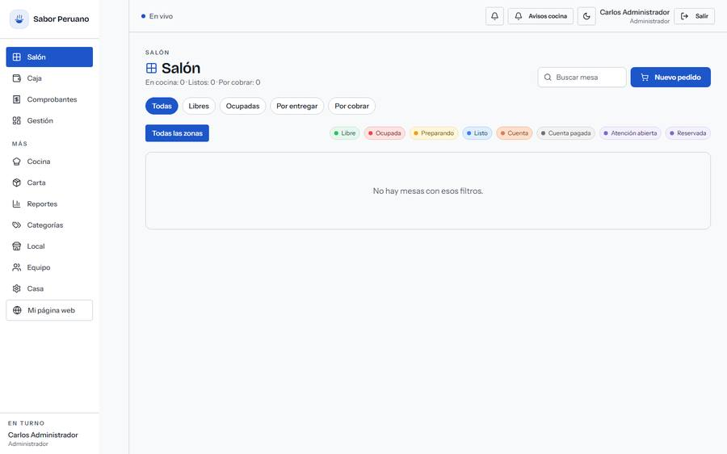 **Salón, escritorio**: ~90 mesas, casi todas de prueba | 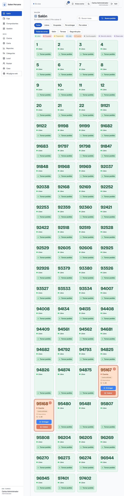 **Salón, tablet 1024 px**: la leyenda desborda la página |
| 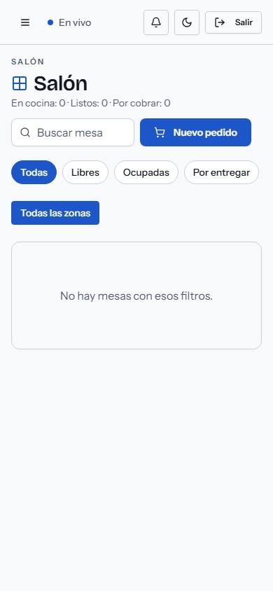 **Salón, móvil** | 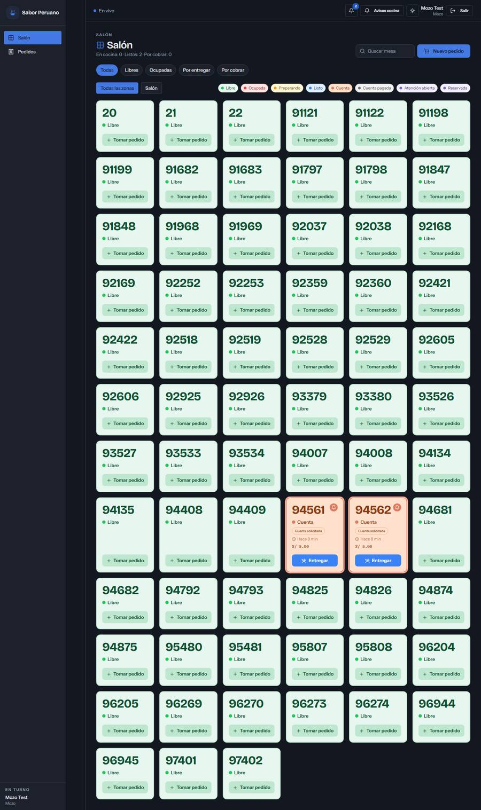 **Salón en modo oscuro**: tarjetas crema sobre app oscura |
| 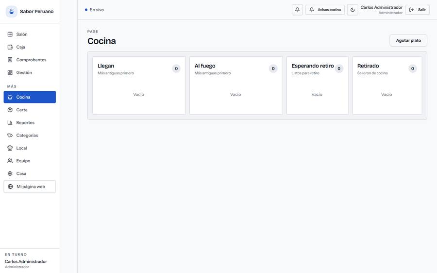 **Pase de cocina**: el nombre de mesa domina el ticket | 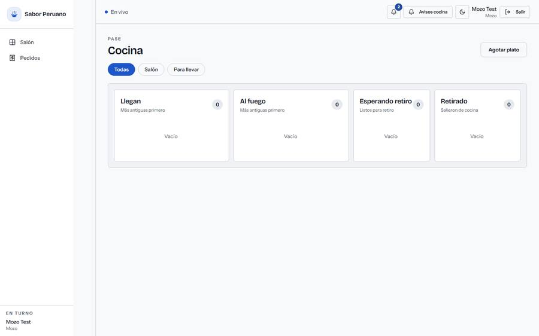 **Pase en modo oscuro** |
| 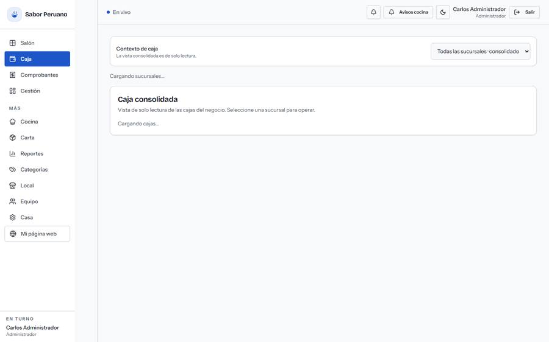 **Caja del admin**: consolidado de solo lectura | 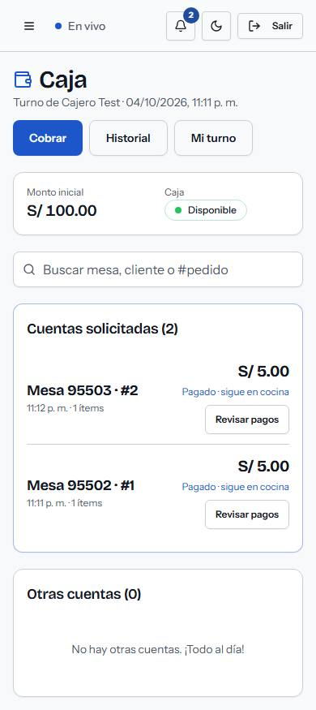 **Caja en móvil** |
| 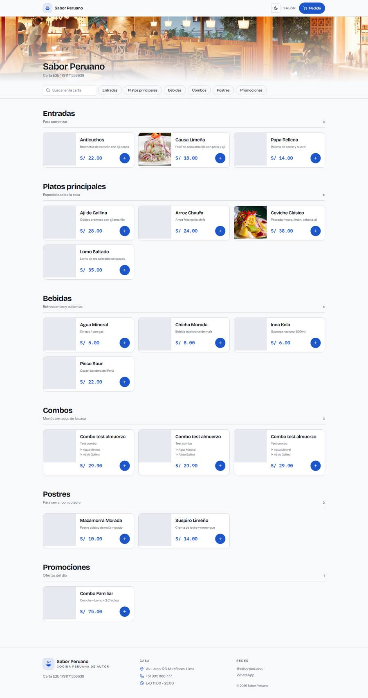 **Carta pública**: placeholders grises y "Carta E2E…" | 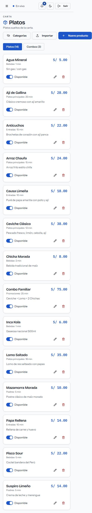 **Productos en móvil**: 29 botones sin nombre |
| 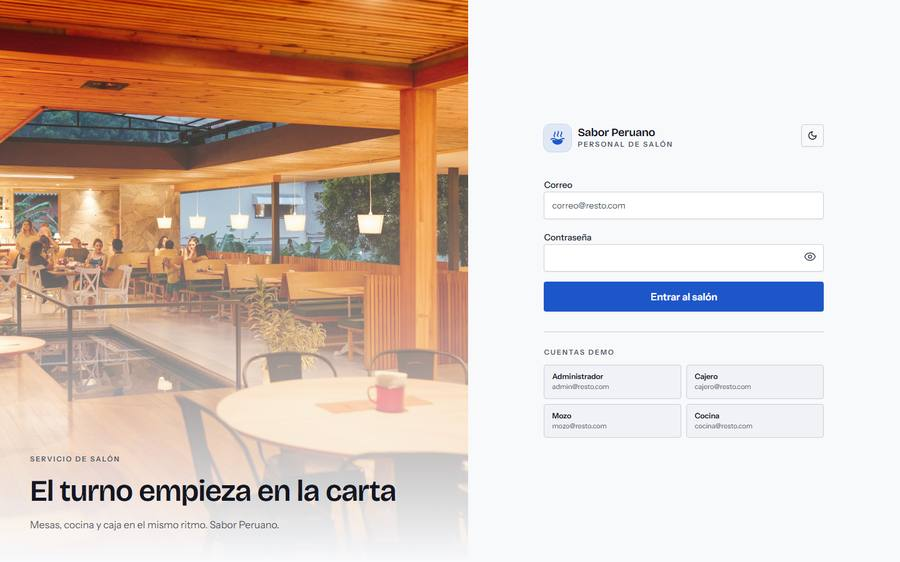 **Login** (10 violaciones de axe) | 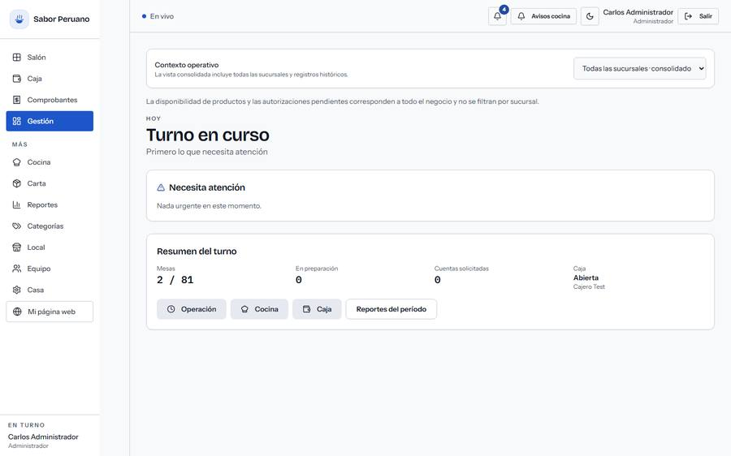 **Dashboard** |
| 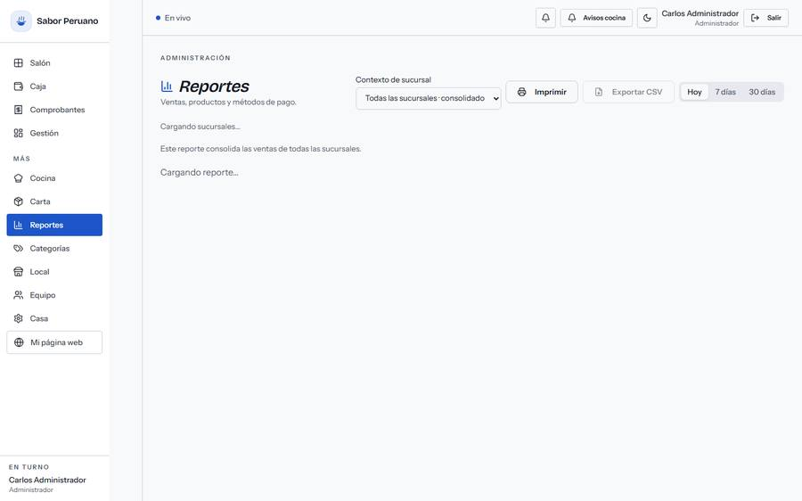 **Reportes** | |

La corrida completa (131 capturas, JSON con cada medición y tablas agregadas) queda en
`frontend/e2e/audit/out/` (`report.json`, `summary.md`, `shots/`).

---

## Anexo: cómo reproducir la auditoría

```powershell
# 1. Chromium lo lanza el wrapper (Node no puede hacer spawn con pipes en el sandbox)
pwsh -ExecutionPolicy Bypass -File frontend/e2e/audit/run-audit.ps1

# Subconjuntos rápidos
pwsh -File frontend/e2e/audit/run-audit.ps1 -Roles admin -Viewports desktop
pwsh -File frontend/e2e/audit/run-audit.ps1 -Script e2e/audit/flows.mjs

# 2. Agregar a tablas
node frontend/e2e/audit/analyze.mjs      # -> out/summary.md
```

- Requiere la app servida en `:3000` y la API en `:8000`, y los usuarios de prueba de
  `frontend/e2e/fixtures/seed-roles.js` para los roles mozo/cajero/cocina.
- `capture.mjs` cubre rutas × roles × viewports; `flows.mjs` recorre diálogos y el cobro **sin
  confirmar ningún pago** (no registra dinero ni cambia estados).
